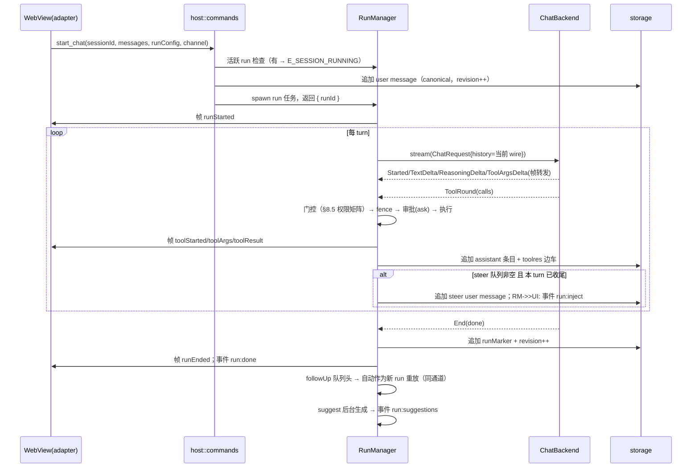
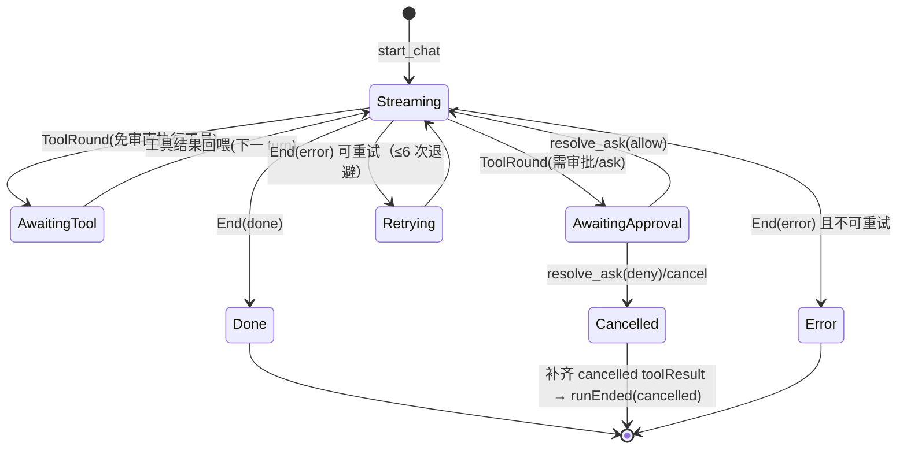
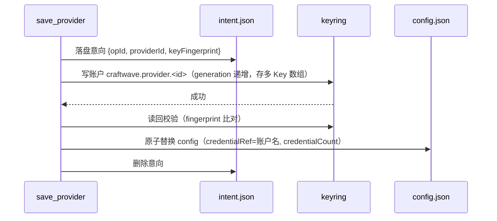

# CraftWave 技术设计文档

| 项 | 内容 |
|---|---|
| 产品名称 | CraftWave —— 本地优先的跨平台桌面 AI Agent |
| 文档版本 | v2.0（覆盖 M0–M3：P0=字段级可直接开工；P1(M2)=契约字段级+组件级；P2(M3)=架构级+接口定义；P3=占位） |
| 日期 | 2026-10-27 |
| 上游文档 | 《功能需求文档.md》v1.0（PRD）、《数据存储调研.md》v1.0 |
| 技术基线 | Tauri 2 · rig 0.46.x（锁定，见 §4.4）· assistant-ui 0.15.x · React 19 · TypeScript 5.x · Tailwind v4 · zustand 5 · tokio（Tauri 内置） |
| 详细度约定 | 契约与数据格式=字段级；核心算法=伪代码/规则级；交互=时序图/状态机；UI=组件规格级。不含实现代码与视觉稿 |

---

## 目录

- [1. 文档说明](#1-文档说明)
- [2. 系统架构总览](#2-系统架构总览)
- [3. IPC 契约（字段级）](#3-ipc-契约字段级)
- [4. rig 防腐层](#4-rig-防腐层)
- [5. Agent 运行时](#5-agent-运行时)
- [6. 消息模型与分支映射](#6-消息模型与分支映射)
- [7. 存储落地](#7-存储落地)
- [8. 工具系统](#8-工具系统)
- [9. 安全设计](#9-安全设计)
- [10. 前端架构](#10-前端架构)
- [11. Provider 适配层](#11-provider-适配层)
- [12. 测试与 CI](#12-测试与-ci)
- [13. 架构决策记录（D9–D15）](#13-架构决策记录d9d15)
- [附录 A：M0 Spike 验证点](#附录-am0-spike-验证点)
- [附录 B：P0 需求可追溯矩阵](#附录-bp0-需求可追溯矩阵)
- [附录 C：未决问题清单](#附录-c未决问题清单)

---

## 1. 文档说明

### 1.1 定位

本文档回答 PRD（v1.0）中 P0–P2（里程碑 M0–M3）需求的"怎么做"，是开发、评审与测试编码工作的直接依据。详细度按里程碑递降分层：**P0（M0+M1）字段级/伪代码级**（可直接开工）；**P1（M2）契约字段级+组件级**（命令/帧/事件/存储格式完整，模块设计到接口与数据流）；**P2（M3）架构级**（接口定义与扩展点，实现方案允许微调）；P3 仅记录架构占位与触发条件。设计单元以【M2】【M3】【P3】标签标注里程碑，未标注者默认 M1。

### 1.2 编写与修订规则

- **可追溯性**：每个设计单元标注其实现的 PRD 需求编号（FR-xx-xx / NFR-xx）；完整映射见附录 B。
- **冲突处理**：本文档不得违反 PRD 的验收标准；设计过程中发现 PRD 缺陷时，修订 PRD 并在本文变更记录中注明，不允许绕开。
- **未决问题**：实现层面尚未定论的事项一律记录于附录 C（含建议默认方案），不阻塞其余章节；统一处理后从清单移除并回写正文。
- **自包含**：与 PRD 一致，本文档可脱离参考仓库源码独立交付；涉及上游库（rig/assistant-ui/Tauri）的事实均内嵌描述并标注版本。

### 1.3 术语（增量于 PRD 术语表）

| 术语 | 定义 |
|---|---|
| run / turn / step | run=用户一次发送到最终答复的完整执行；turn=run 内一次模型调用周期（模型输出→工具批→回喂）；step=帧流中的轮次计数（与 turn 同值，用于前端分组） |
| wire 消息 | 发给模型的协议中立消息（role + parts），由会话条目重建 |
| canonical 历史 | Rust 持久化的权威消息序列（会话 JSONL），前端展示树是其超集（分支） |
| 帧序列号 seq | Channel 每帧自增计数，用于对账与去重 |
| session revision | 会话修订号，每次 canonical 追加或树同步成功后 +1，用于乐观并发 |
| 镜像工具 | 前端 defineToolkit 声明的后端工具副本，仅用于渲染与结果桥接，不在前端执行 |

---

## 2. 系统架构总览

### 2.1 进程与运行时模型（实现 FR-13-10 单实例、D1 单进程）

单一 Tauri 2 进程：

- **WebView 进程**（React 应用）：聊天运行态（assistant-ui LocalRuntime）、应用状态（zustand）、IPC 客户端。
- **Rust 主进程**：tokio 多线程运行时（Tauri 内置）。`#[tauri::command]` async 命令运行其上；每个 run 以 `tokio::spawn` 独立任务执行，通过 `CancellationToken` 取消。
- 单实例互斥：tauri-plugin-single-instance，二次启动向既有实例转发 `activate_and_show`。
- 窗口与启动（FR-13-04、NFR-01）：自绘标题栏 = tauri-plugin-decoration 覆盖式标题栏（C-7 已定——3.0.5 × tauri 2.12 兼容，见附录 C）。激活协议（兼作防闪启动 + 亮窗看门狗）：窗口以 `visible:false` + `titleBarStyle:"Overlay"` + `hiddenTitle` 启动 → 前端调 `activate_decoration`（macOS 另调 `set_traffic_lights_inset` 定位交通灯）→ documentElement 出现 `data-tauri-plugin-decoration-active` 再亮窗 → 5s 超时调 `restore_decoration` 退化系统标题栏并无条件亮窗。冷启动预算分解——Rust 侧仅读 config + index.json（<50ms 量级），首屏只加载当前会话历史，历史加载异步于首帧渲染。
- 关闭到托盘：主窗口 close 请求拦截 → 隐藏窗口继续运行（后台运行语义，FR-13-06/07）；存在活跃 run 时经 `app:exit_requested` 事件 + `resolve_exit_request` 命令确认后退出。

### 2.2 Rust 模块划分（D9：M1 单 crate 模块化单体）

```
src-tauri/src/
├── main.rs / lib.rs        # Tauri builder、插件注册、命令注册表
├── host/                   # IPC 层：命令实现（校验/转调）、事件汇、通知、托盘、菜单、退出拦截
│   ├── commands/           # 按域分文件：system/config/provider/project/session/workspace/toolres/ui_state
│   ├── events.rs           # 事件键常量 + emit 封装（供契约测试扫描）
│   └── notify.rs           # 系统通知（三平台）+ notify:activate 回跳
├── agent/                  # 运行时：RunManager、run 状态机、steer/followUp 队列、对账快照
├── backend/                # rig 防腐层：中立 trait + RigAgentBackend + ScriptedBackend(测试)
├── providers/              # 供应商解析（CW schema v2 → rig Model）、Key 池、错误分类
├── tools/                  # 工具注册表 + 各工具实现（read/edit/command/…）+ 批次调度
├── safety/                 # 权限档过滤、审批门、命令围栏(fence)、safe_join、删除守卫、SSRF(P1)
├── storage/                # 会话 JSONL、索引、配置协调器、原子写、toolres 边车、UI 状态
├── knowledge/              # 系统提示组装器（M1：核心提示+权限档块+项目指令）；skills/memory P1
└── util/                   # atomic.rs（原子写）、ids、time、test_support
```

模块依赖方向单向：`host → agent → backend/tools/providers → safety/storage`；`tools` 与 `agent` 互相只通过接口（ToolRegistry）交互。M1 不拆 workspace 多 crate（编译时长与重构成本不划算），crate 边界以模块纪律代替，1.x 若需要再物理拆分。

### 2.3 数据流总览

```
用户发送 → Composer → ChatModelAdapter.run()
  → invoke("start_chat", {sessionId, messages, runConfig, channel})
    → RunManager 启动 run 任务：
        组装(权限档工具集 + 系统提示 + 历史重建) → RigAgentBackend.stream()
        事件流 → 帧节流(64ms) → channel.send(ChatFrame)
        工具轮 → fence/审批门(ask) → 工具执行 → toolres 边车 + canonical 追加
        终态 → runEnded 帧 + run:done 事件 + 建议生成(suggest)
  ← 前端：帧 → assistant-ui parts 累积 yield / runMetrics store / 工具卡片桥接
```

### 2.4 前端目录结构

```
ui/src/
├── app/                    # 路由壳、三栏布局、主题 Provider、i18n 接入
├── ipc/                    # client.ts（唯一 invoke 出口）、types.ts（与 Rust 契约镜像）、events.ts（事件绑定）
├── chat/                   # assistant-ui 接入：runtime.ts(adapter)、toolkit/(镜像工具+卡片)、
│                           #   parts/(run 标记/折叠渲染)、Thread/Composer 组装
├── composer/               # ghost-hint.tsx、token-bar.tsx、permission-tier.tsx
├── panels/                 # 左栏会话树、右栏 Inspector（M1：用量+会话信息；产物/计划 P1 入驻）
├── ask/                    # AskPanel（询问/审批覆盖层）
├── stores/                 # sessions/settings/runMetrics/askHint（zustand）
└── i18n/ theme/            # zh-CN/en-US 资源；主题 token（Tailwind v4 CSS 变量）
```

---

## 3. IPC 契约（字段级）

> 实现 PRD §3.3 三通道与附录 D；本节是其 P0 切片的字段级展开。契约测试见 §12.3。

### 3.1 通用约定（D14）

| 约定 | 内容 |
|---|---|
| 命令名 | snake_case，与 Rust `#[tauri::command]` 函数名一致（如 `invoke("start_chat")`） |
| 负载字段 | 一律 camelCase：Rust 结构体 `#[serde(rename_all = "camelCase")]`；TS 接口 camelCase；TS 类型经 `ipc/types.ts` 手工镜像（生成器见附录 C-2） |
| 可选字段 | 显式 `?` / `Option`，无 null 满字段；时间戳 epoch 毫秒 int64（TS number，JSON 序列化位数足够） |
| 错误 | 命令失败统一 reject `{ code: string, message: string, detail?: unknown }`；code 全集见 §3.6 |
| Channel | `tauri::ipc::Channel<ChatFrame>`，Rust 端 `serde` 序列化后发送；帧自带 `seq`（见 ChatFrame 基座） |
| 事件 | `emit_to("main", key, payload)`；payload 均含 `sessionId`（全局事件除外） |

### 3.2 共享类型（TS 定义，Rust 侧逐一镜像）

```ts
// ---- 供应商（CW schema v2，实现 FR-02-01/06/07）----
interface ProviderConfig {
  id: string;                    // uuid
  name: string;
  apiFormat: "openai_chat" | "anthropic_messages" | "openai_responses";
  baseUrl?: string;              // 缺省按 apiFormat 用官方缺省地址
  credentialRef?: string;        // keyring 账户引用；config 永不存明文 Key
  credentialCount: number;       // 展示用 Key 数量
  models: ProviderModel[];
  headers?: Record<string, string>;
}
interface ProviderModel {
  id: string;                    // uuid，activeModelId 指向它
  model: string;                 // wire id，即显示名
  maxTokens: number;             // default 32768
  contextWindow: number;         // default 128000
  reasoningEffort?: "default" | "low" | "medium" | "high" | "max";
  vision?: boolean;
}

// ---- 应用配置（实现 FR-14）----
interface AppConfig {
  schemaVersion: 2;
  providers: ProviderConfig[];
  activeModelId?: string;
  proxy?: { mode: "none" | "system" | "manual"; url?: string };
  approval: { enabled: boolean; autoConfirm: boolean; commandAllowlist: string[] };
  ui: { language: "zh-CN" | "en-US"; theme: "light" | "dark" | "system"; aiLanguage?: string };
  log: { level: "debug" | "info" | "warn" | "error" };
}

// ---- 项目与会话（实现 FR-10-01、FR-01-01/02）----
interface ProjectMeta { id: string; name: string; homeDir: string; createdAt: number; }
interface SessionMeta {
  id: string; projectId?: string;      // 无 = 临时会话
  title: string; createdAt: number; updatedAt: number;
  revision: number;                    // 乐观并发（§6.4）
  messageCount: number; totalTokens: number;
}

// ---- 消息（wire 中立格式，D8 载体）----
type WireMessage = {
  id: string; parentId?: string;       // 树结构；分支见 §6
  role: "user" | "assistant" | "system";
  parts: WirePart[]; createdAt: number;
};
type WirePart =
  | { type: "text"; text: string }
  | { type: "reasoning"; text: string }
  | { type: "toolCall"; callId: string; name: string; argsJson: string }
  | { type: "toolResult"; callId: string; ok: boolean; summary: string }
  | { type: "planSnapshot"; items: PlanItem[] }
  | { type: "runMarker"; runId: string; startedAt: number; endedAt?: number;
      durationMs?: number; toolCount?: number }
  | { type: "image"; blobHash: string; mimeType: string };            // 【M2】附件/读图，blob 见 §7.7

interface PlanItem { id: string; text: string; status: "pending" | "in_progress" | "completed"; }

// ---- 运行配置与快照（实现 FR-03-01/08、FR-05-01）----
interface RunConfig {
  modelId?: string;                    // 会话级覆盖；缺省全局 active
  tier: "plan" | "confirm_each" | "auto_edit" | "full_access";
  maxTurns: number;                    // default 24
  steer: boolean;                      // 本次发送是否为 steer 注入（true 时不新建 run）
}
interface UsageTotal { input: number; output: number; cacheRead: number; cacheWrite: number; }
interface RunSnapshot {                // session_run_snapshot 返回；对账用（FR-03-08）
  status: "idle" | "running";
  runId?: string; startedAt?: number; turn?: number; toolCount?: number;
  usage: UsageTotal; lastSeq: number;  // lastSeq=已发出最大帧序号
}

// ---- 询问/审批（实现 FR-05-02/03/04）----
type AskPayload =
  | { kind: "question"; title: string;
      questions: { id: string; text: string; options?: { id: string; label: string }[];
                   allowFreeText: boolean }[] }
  | { kind: "approval"; title: string;
      diff?: { path: string; hunks: { header: string; lines: { kind: "add" | "del" | "ctx"; text: string }[] }[] };
      command?: string; fenceReason?: string;
      options: { id: string; label: string; recommended?: boolean;
                 mode?: "allow_once" | "always_session" | "deny" }[] }
  | { kind: "mcpTrust"; server: string; transport: "stdio" | "http";      // 【M2】MCP 启动信任（FR-08-03）
      fingerprint: string; commandOrUrl: string;
      options: { id: "allow_once" | "remember" | "deny" }[] }
  | { kind: "projectTrust"; resourceName: string; fingerprint: string;   // 【M2】项目资源信任（FR-05-10）
      options: { id: "allow_session" | "remember" | "deny" }[] };
type AskAnswer =
  | { kind: "question"; answers: Record<string, string> }   // qid -> 选项 id 或自由文本
  | { kind: "approval"; optionId: string; editedCommand?: string };
```

### 3.3 命令注册表（P0 全集 31 个 + P1 预留 6 席）

| # | 命令 | 参数 → 返回 | 说明 |
|---|---|---|---|
| 1 | `ping` | `{}` → `{ pong: true, version: string }` | 连通性 |
| 2 | `app_version` | `{}` → `string` | 版本号 |
| 3 | `open_dir` | `{ path: string }` → `void` | 系统打开目录（校验在 roots/数据目录白名单内） |
| 4 | `open_url` | `{ url: string }` → `void` | 系统 https 打开 |
| 5 | `select_dir` | `{}` → `string \| null` | 原生目录选择 |
| 6 | `get_config` | `{}` → `AppConfig` | |
| 7 | `save_config` | `{ config: AppConfig }` → `AppConfig` | 经配置协调器（§7.6）原子落盘，返回归一化结果 |
| 8 | `save_provider` | `{ provider: ProviderConfig, newKey?: string }` → `ProviderConfig` | newKey 存 keyring 后仅落引用（§9.4 协议） |
| 9 | `delete_provider` | `{ providerId: string }` → `void` | 同步删除 keyring 账户 |
| 10 | `list_projects` | `{}` → `ProjectMeta[]` | |
| 11 | `save_project` | `{ project: { id?: string; name: string; homeDir: string } }` → `ProjectMeta` | 新建/更新；homeDir 变更触发数据目录重绑 |
| 12 | `delete_project` | `{ projectId: string }` → `void` | 不删除项目数据目录 |
| 13 | `create_session` | `{ projectId?: string }` → `SessionMeta` | 项目会话固化 roots 快照 |
| 14 | `list_sessions` | `{ projectId?: string }` → `SessionMeta[]` | 按 updatedAt 倒序 |
| 15 | `load_session` | `{ sessionId: string }` → `SessionData` | `SessionData = { meta, messages: WireMessage[], activeLeafId?: string }`；全量（分页 P2） |
| 16 | `delete_session` | `{ sessionId: string }` → `void` | 运行中拒绝（E_SESSION_RUNNING） |
| 17 | `rename_session` | `{ sessionId, title }` → `SessionMeta` | |
| 18 | `start_chat` | `{ sessionId, messages: WireMessage[], runConfig: RunConfig, channel }` → `{ runId: string }` | 详 §5.2；同会话已有 run → E_SESSION_RUNNING（steer 走 21） |
| 19 | `cancel_run` | `{ sessionId: string }` → `boolean` | CancellationToken 置位即返回 true |
| 20 | `session_run_snapshot` | `{ sessionId }` → `RunSnapshot \| null` | 对账（§5.6） |
| 21 | `inject_run_message` | `{ sessionId, text: string }` → `{ queued: boolean }` | queued=true=steer 已被运行中 run 接纳；false=无活跃 run（M1 前端收到 false 转为普通 start_chat 发送，§5.5） |
| 22 | `resolve_ask` | `{ askId: string, answer: AskAnswer }` → `void` | 超时/取消返回 E_NOT_FOUND |
| 23 | `resolve_exit_request` | `{ accepted: boolean }` → `void` | 退出确认（FR-13-06） |
| 24 | `get_session_prefs` | `{ sessionId }` → `{ modelId?: string }` | |
| 25 | `set_session_prefs` | `{ sessionId, prefs: { modelId?: string } }` → `void` | 权限档不持久化（PRD FR-14-05） |
| 26 | `save_session_tree` | `{ sessionId, messages: WireMessage[], activeLeafId?: string, baseRevision: number }` → `{ revision: number }` | 分支同步（§6.4）；指纹校验失败 E_SESSION_REV |
| 27 | `search_workspace_paths` | `{ sessionId, query: string, limit?: number }` → `{ path: string; kind: "file"\|"dir" }[]` | @ 引用补全（FR-09-05） |
| 28 | `read_workspace_file` | `{ sessionId, path: string, range?: { offset: number; limit: number } }` → `{ content: string; truncated: boolean }` | 预览读取（roots 内校验）；单次响应 ≤512KB——无 range 读文件开头 + `truncated=true`，range 按行翻页；不设文件级拒读硬限；编码自动判断（BOM→严格 UTF-8→chardetng 探测，与 read 工具共用解码器，C-10 已定）；前 8KB 含 NUL 判二进制 → 报错不支持文本预览 |
| 29 | `load_tool_outcomes` | `{ sessionId, callIds: string[] }` → `Record<string, ToolOutcomeJson>` | 工具卡恢复（FR-04-07） |
| 30 | `get_ui_state` | `{}` → `unknown`（Json 原样） | |
| 31 | `set_ui_state` | `{ state: unknown }` → `void` | 防抖由前端负责 |
| 32–37 | （P1 预留，v0.2 展开） | | `test_provider`、`mcp_*`、`git_*`、`stats_*`、`logs_*`、外部目录授权 |

**M2（P1）命令 28 个（#32–59）**：

| # | 命令 | 参数 → 返回 | 说明 |
|---|---|---|---|
| 32 | `test_provider` | `{ providerId, baseUrlOverride? }` → `{ ok, latencyMs?, models?: string[], error? }` | 连通性测试（FR-02-09）：models 拉取或最小补全 |
| 33 | `check_external_path` | `{ sessionId, path }` → `{ allowed, insideRoots }` | 外部目录预检（FR-05-12） |
| 34 | `allow_external_dir` | `{ sessionId, dir }` → `{ roots: string[] }` | "始终允许"授权并入会话 roots |
| 35 | `list_editors` | `{}` → `{ name, path }[]` | 编辑器探测 |
| 36 | `open_in_editor` | `{ path, line? }` → `void` | |
| 37 | `git_status` | `{ sessionId }` → `{ files: { path, status }[] }` | git2 只读（FR-11-01） |
| 38 | `git_diff` | `{ sessionId, staged? }` → `{ patches: DiffPatch[] }` | 工作区 vs HEAD 聚合 diff |
| 39 | `git_recent_log` | `{ sessionId, limit? }` → `{ commits: { sha, summary, time }[] }` | |
| 40 | `mcp_list_config` | `{}` → `{ global, project }` | 双作用域配置（FR-08-02），保留未知字段 |
| 41 | `mcp_save_config` | `{ scope, config }` → `void` | |
| 42 | `mcp_connect` | `{ scope, name }` → `void` | 触发 TOFU（§9.7） |
| 43 | `mcp_disconnect` | `{ scope, name }` → `void` | |
| 44 | `mcp_reconnect` | `{ scope, name }` → `void` | |
| 45 | `mcp_test` | `{ draft }` → `{ ok, tools: { name, description }[], error? }` | 草稿测试，总预算 60s |
| 46 | `mcp_set_launch_trust` | `{ fingerprint, decision }` → `void` | TOFU 决策写 keyring |
| 47 | `mcp_snapshot` | `{}` → `{ servers: { name, state, toolCount }[] }` | 连接池状态快照 |
| 48 | `skill_list` | `{}` → `{ name, source, enabled, description }[]` | 多来源合并（FR-09-02） |
| 49 | `skill_toggle` | `{ name, enabled }` → `void` | |
| 50 | `skill_reload` | `{}` → `void` | 重扫全部来源 |
| 51 | `skill_inspect` | `{ name }` → `{ markdown }` | |
| 52 | `stats_token` | `{ range?: { from, to } }` → `{ byDay[], byModel[], total }` | 用量统计（FR-02-13） |
| 53 | `quota_snapshots` | `{}` → `{ providerId, state, data?, fetchedAt }[]` | 订阅/余额六态（FR-02-15，§11.5） |
| 54 | `read_session_log` | `{ sessionId, tail? }` → `{ lines: string[] }` | 会话日志（FR-15-01） |
| 55 | `list_log_files` | `{}` → `string[]` | |
| 56 | `open_logs_dir` | `{}` → `void` | |
| 57 | `attach_run` | `{ sessionId, channel, sinceSeq }` → `{ runId?, replayed: number }` | 帧重放重连（§5.8） |
| 58 | `stop_subagent` | `{ subId }` → `void` | 级联取消（§5.9） |
| 59 | `load_subagent_history` | `{ sessionId, subId }` → `WireMessage[]` | 子代理抽屉回看（FR-07-06） |

**M3（P2）命令 13 个（#60–72）**：

| # | 命令 | 参数 → 返回 | 说明 |
|---|---|---|---|
| 60–65 | `scheduler_list / create / update / delete / set_enabled / run_now` | `{ task: { name, schedule: { kind: "cron"\|"every"\|"once", expr }, prompt, tier } … }` | 定时任务 CRUD（FR-03-12，§5.10） |
| 66 | `service_list` | `{}` → `{ id, name, state }[]` | 后台服务（FR-03-13） |
| 67 | `stop_service` | `{ id }` → `void` | |
| 68 | `activity_snapshot` | `{}` → `{ needAttention[], running[], recent[] }` | 运行总览（FR-03-10） |
| 69 | `index_status` | `{}` → `{ builtAt, entries, state }` | 索引状态（FR-14-09） |
| 70 | `index_rebuild` | `{}` → `{ started: boolean }` | 手动重建（§7.8） |
| 71 | `workspace_tree` | `{ sessionId, path? }` → `{ nodes }` | 文件树面板（FR-10-05） |
| 72 | `mcp_read_resource` | `{ scope, name, uri }` → `{ contents }` | MCP 资源读取（FR-08-07） |

`ToolOutcomeJson = { ok: boolean; data?: unknown; error?: string; uiSummary: string; detail?: unknown }`。

### 3.4 Channel 帧定义（ChatFrame，P0 全集 9 种）

```
帧基座：所有帧先序列化为 { seq: number, type: string, ts?: number, ...字段 }（seq 由 Rust 端 RunHandle 递增；ts=Rust 出口 epoch ms，可选字段，供端到端延迟埋点与 §5.6 对账——S2 实证加入，向后兼容）

runStarted   { seq, type:"runStarted", runId, model: string }            // model=显示名
stepStarted  { seq, type:"stepStarted", turn: number }                    // turn 从 1 起
textDelta    { seq, type:"textDelta", turn, delta: string }
reasoningDelta { seq, type:"reasoningDelta", turn, delta: string }
toolStarted  { seq, type:"toolStarted", callId, name: string }
toolArgs     { seq, type:"toolArgs", callId, chunk: string }              // 参数增量 JSON 片段
toolResult   { seq, type:"toolResult", callId, ok, uiSummary: string,
               error?: { code: string; message: string } }
usage        { seq, type:"usage", usage: UsageTotal, rate?: number }      // rate=输出 tok/s（FR-01-13）
runEnded     { seq, type:"runEnded", reason: "done"|"error"|"cancelled",
               durationMs: number, toolCount: number, turn: number,
               error?: { code: string; message: string } }
```

排序规则：Rust 端保证 seq 严格递增且与发送顺序一致；toolResult 必晚于同 callId 的全部 toolArgs；同一调用的 toolStarted.callId 与 toolArgs.callId **同源**（= 模型 call id，S2 实证约定——前端镜像工具卡按 callId 与 toolResult 配对）。

节流语义（64ms，S2 实证钉死）：**首增量立即出帧，其后相邻 flush 间隔 ≥64ms**（事件驱动，非固定 tick）——朴素 tick 会让首帧平白多等一个窗口相位，损害 TTFT。NFR-02（<100ms）实测余量：Rust 侧上界 = 64ms 窗口 + 亚毫秒桥接开销（TTFT 实测 0.4ms、单帧 0.4ms），前端 FrameBuffer 处理亚毫秒，渲染余量 >35ms。

**【M2】增补帧 6 种**（帧 type 命名空间与 P0 连续，复用同一 seq 序列）：

```
toolProgress { seq, type:"toolProgress", callId, message: string }        // 长任务进度（命令 tail/服务状态）
subStarted   { seq, type:"subStarted", callId, subId, role: string }      // 子代理委派开始
subFrame     { seq, type:"subFrame", subId, frame: ChatFrame }            // 子代理帧透传（一层嵌套，嵌套子代理展平）
subReport    { seq, type:"subReport", subId, report: string }             // <report> 结构化汇报
subDone      { seq, type:"subDone", subId, outcome: "report"|"partial"|"no_report"|"cancelled" }
compactDone  { seq, type:"compactDone", cutEntryId, tokensBefore, tokensAfter }
```

【M3】无新增帧：浏览器/文档/检索工具结果统一走既有 `toolResult`；服务状态走事件。

### 3.5 事件定义（P0 18 键；M2 增 10 键；M3 增 3 键；共 31，上限 32）

| 键 | payload | 触发时机 |
|---|---|---|
| `run:start` | `{ sessionId, runId }` | run 任务确认启动 |
| `run:done` | `{ sessionId, runId, durationMs }` | 正常终态 |
| `run:error` | `{ sessionId, runId, code, message }` | 异常终态 |
| `run:cancelled` | `{ sessionId, runId }` | 用户取消 |
| `run:retry` | `{ sessionId, runId, attempt, code }` | 可恢复错误自动重试 |
| `run:inject` | `{ sessionId, runId, acceptedAtTurn?: number }` | steer 被消费（checkpoint 后回执） |
| `run:suggestions` | `{ sessionId, runId, text: string }` | suggest 生成完成（FR-06-09） |
| `tool:start` / `tool:result` / `tool:error` | `{ sessionId, runId, callId, name?, ok?, code? }` | 跨 Tab 监听用（帧的镜像） |
| `plan:update` | `{ sessionId, items: PlanItem[] }` | plan 工具变更 |
| `tokens:update` | `{ sessionId, usage: UsageTotal }` | 会话累计（FR-01-13 会话口径） |
| `ask:opened` | `{ sessionId, askId, payload: AskPayload }` | 询问/审批开启（AskPanel 弹出） |
| `ask:closed` | `{ askId, answered: boolean }` | 已答/已取消 |
| `session:title` | `{ sessionId, title }` | 自动标题（FR-01-09，P1 实装、键位 M0 定死） |
| `notify:activate` | `{ sessionId, runId?, anchor?: { kind: "ask" \| "runEnd"; ref?: string } }` | 系统通知点击回跳 |
| `menu:action` | `{ action: "settings" \| "about" \| "check_update" }` | macOS 原生菜单 |
| `app:exit_requested` | `{ hasActiveRuns: boolean }` | 托盘/关闭退出且有活跃 run |

**【M2】增补 10 键**：

| 键 | payload | 触发时机 |
|---|---|---|
| `run:compacting` / `run:compacted` / `run:compact_failed` | `{ sessionId, tokensBefore?, tokensAfter? }` | 自动/手动压缩生命周期（FR-03-05） |
| `sub:spawn` / `sub:step` / `sub:report` / `sub:usage` / `sub:done` / `sub:error` | `{ sessionId, runId, subId, role?, turn?, usage?, outcome?, code? }` | 子代理生命周期（FR-07，跨 Tab 可见） |
| `mcp:status` | `{ scope, name, state: "starting"\|"ready"\|"stopped"\|"error", detail? }` | 连接池状态变化（FR-08-05） |

**【M3】增补 3 键**：

| 键 | payload | 触发时机 |
|---|---|---|
| `service:update` | `{ serviceId, state: "running"\|"stopped"\|"unknown" }` | 后台服务 3s 对账轮询（FR-03-13） |
| `scheduled:fired` / `scheduled:done` | `{ taskId, runSessionId? }` | 定时任务触发/完成（FR-03-12） |

### 3.6 错误码注册表

| code | 域 | 语义 |
|---|---|---|
| E_INVALID_ARG | 通用 | 参数校验失败 |
| E_NOT_FOUND | 通用 | 目标不存在 |
| E_INTERNAL_STATE | 安全 | 试图写宿主内部状态（FR-05-08） |
| E_SESSION_RUNNING | 会话 | 会话已有活跃 run |
| E_SESSION_REV | 会话 | 树同步基线过期（§6.4） |
| E_CANCELLED | 会话 | 操作被取消 |
| E_PROVIDER_AUTH / E_PROVIDER_BILLING / E_PROVIDER_RATE_LIMITED / E_PROVIDER_BAD_REQUEST / E_PROVIDER_SERVER / E_PROVIDER_PROTOCOL / E_PROVIDER_NETWORK | 供应商 | 七类（FR-03-04），auth/billing 不自动重试 |
| E_KEYRING | 凭据 | 钥匙串读写失败 |
| E_PATH_OUTSIDE_ROOTS | 安全 | 路径越界（FR-05-06） |
| E_DELETE_GUARDED | 安全 | 删除守卫命中 |
| E_FENCE_BLOCKED | 安全 | 命令围栏 Block（FR-05-05） |
| E_TOOL_BLOCKED | 工具 | 权限档排除（FR-05-01） |
| E_PLAN_STALE | 计划 | 已批准计划过期仍写（FR-06-02 默认策略） |
| E_PLAN_REQUIRED | 计划 | 严格硬门开启时空计划写（默认关，§8.6） |
| E_EDIT_NO_MATCH / E_EDIT_AMBIGUOUS / E_EDIT_VERSION_STALE | edit | 匹配失败/多命中/版本过期（§8.4） |
| E_RUN_STALLED | 运行时 | 流停滞看门狗（【M2】实装，§5.7） |
| E_PROJECT_UNTRUSTED | 安全 | 未信任的项目资源访问/注入（【M2】，§9.8） |
| E_SUB_BUDGET | 子代理 | 子代理步数/预算耗尽（【M2】，§5.9） |
| E_FILE_CLAIMED | 子代理 | 跨文件认领冲突（【M2】，§5.9） |

---

## 4. rig 防腐层

### 4.1 目标（实现 D6、风险 R1）

业务代码（agent/tools/providers 之外）不 import rig 具体类型；rig 升级只改 `backend/rig_impl.rs` 与 `providers/` 两处。

### 4.2 中立接口

```rust
// backend/mod.rs —— 业务侧唯一可见的类型
pub enum BackendEvent {
    Started { model: String },
    TextDelta(String),
    ReasoningDelta(String),
    ToolArgsDelta { call_id: String, name: String, chunk: String },
    ToolRound(Vec<ToolInvocation>),        // 本 turn 全部调用解析完毕（参数 JSON 完整）
    Usage(UsageTotal),
    End { reason: EndReason; error: Option<BackendError> },
}
pub struct ChatRequest {                   // 一次 run 的完整输入
    pub model: ResolvedModel,              // §11.1
    pub system: String,                    // knowledge 组装结果
    pub history: Vec<WireMessage>,         // wire 中立
    pub tools: Vec<ToolSpec>,              // 权限档过滤后的全集
    pub max_turns: u32,
}
pub trait ChatBackend: Send + Sync {
    fn stream(&self, req: ChatRequest) -> BoxStream<'static, anyhow::Result<BackendEvent>>;
}
```

### 4.3 两个实现

- **RigAgentBackend**：实现载体为 rig `run::AgentRun`（**sans-IO 状态机**，S3 实证）+ `StreamedTurnAssembler`。RunLoop 驱动单元是 AgentRun 步进（见 §5.2）：`next_step()` → `CallModel{prompt,history,turn}` 时经 `prepare_request`（RunSpec+ProviderCapabilities）→ `PreparedRequest::apply(CompletionRequest)` → `Model::stream`，流事件边经 `assembler.ingest` 记账边桥接为 BackendEvent/Channel 帧（文本/思考 delta、工具参数增量含半截 JSON），turn 末 `record_streamed_completion_call`（usage/finish_reason）+ `run.streamed_turn()` 收口；`CallTools{calls}` 时宿主执行工具并 `answer_all` 回喂。**审批挂起 = CallTools 步骤上把整只 run `serde_json` 序列化挂起、反序列化恢复继续**——天然支持跨重启恢复审批（S3 实证），backend 无需改为 AgentHook::Dispatch 拦截路线。确证点见附录 A Spike S2/S3。
- **ScriptedBackend**：按脚本回放 BackendEvent 序列，供全部 agent 层单测/集成测试使用（无网络、确定性、毫秒级）。

### 4.4 版本与升级策略

- 锁定 `rig = "0.45.0"`（S2/S3 双版本实证：0.45.0 与 0.46.0-rc.1 宿主代码零改动全绿、延迟同量级，见附录 C-6）。**MSRV 随 rig 走**：rig 0.45.0 要求 Rust 1.97.1，rust-toolchain.toml 已自 1.97.0 抬升。
- 升级流程：单独 PR → ScriptedBackend 全量回归 + 真实 provider 冒烟（人工）→ 合并；MIGRATING.md 为必读清单。注意 cargo pre-release 匹配规则：需求串 `0.46.0-rc.1` 不会自动升级到 0.46.0 stable，换版必须手动改。

---

## 5. Agent 运行时

### 5.1 RunManager

```rust
pub struct RunManager { runs: DashMap<SessionId, Arc<RunHandle>> }
pub struct RunHandle {
    pub run_id: RunId,
    pub cancel: CancellationToken,
    pub state: Mutex<RunState>,        // 快照可读
    pub frames: Channel<ChatFrame>,   // run 生命期内有效
    pub seq: AtomicU64,
    pub steer_tx: mpsc::Sender<SteerMsg>,   // 容量 32
    pub ask: Mutex<Option<AskSlot>>,       // 当前未决 ask（oneshot 回执）
}
pub struct RunState { status, started_at, turn, tool_count, usage, last_seq, plan: Option<PlanState> }
```

### 5.2 start_chat 命令流程（时序）



RunLoop 驱动单元（S2/S3 实证修订）：上图"每 turn"循环即 `rig::run::AgentRun` 步进循环——`CallModel` 步骤完成一次流式模型调用（边收边出帧）；`CallTools` 步骤即审批挂起点：门控/审批未决时把整只 run 序列化挂起（可跨重启恢复），批准并执行后 `answer_all` 回喂，继续下一拍。

### 5.3 run 状态机（FR-03-01/02/03/06）



不变量：终态前三件事必做——取消中工具收齐（补 `E_CANCELLED` 结果）、canonical 追加 runMarker、快照 status 置 idle。取消传播：`cancel_run` 置 CancellationToken → backend 流 drop + 工具任务 abort（进程组收割，§8.3）。

### 5.4 工具门控与执行（RunLoop 内）

每个 ToolRound：① 权限档排除（E_TOOL_BLOCKED 帧内标记，不中断 run）→ ② 同批写路径冲突检测（重复即后一个拒绝）→ ③ fence（command 专属，Allow/Confirm/Block）→ ④ 审批门（confirm_each 档的写类/网络类，或 fence=Confirm）→ ⑤ 执行（文件写全局串行队列，其余并发≤4）→ ⑥ 双通道结果（帧 toolResult + toolres 边车落盘）→ ⑦ 模型侧 compact 文本回喂（§8.2）。审批实现：RunLoop 挂起该工具的 oneshot，`ask:opened` 事件携带 AskPayload；AskPanel 应答 → `resolve_ask` → oneshot 唤醒。默认无限等待；autoConfirm 开启时 300s 超时自动选 recommended 项（灾难级除外）。

### 5.5 steer / followUp（FR-01-07）

- 运行中 `inject_run_message`：入 `steer_tx`；消费点=turn 边界（工具批结果回喂后、下一次 model 调用前）——追加 user 条目并注入下一请求；回执 `run:inject{acceptedAtTurn}`。带图消息（P1）不入 steer，进 followUp。
- run 结束后 `inject_run_message`：**【M1】前端驱动**——前端收到 runEnded 且本地有待发队列时自行重新 start_chat；**【M2】后端会话级 followUp Vec**：run 终态处理完队列头自动新开 run，经 attach_run（§5.8）向已重连的前端转发帧（附录 C-3 已按此定案）。
- 取消 run：队列内容随 run 终结丢弃（前端草稿区返还展示）。

### 5.6 对账协议（FR-03-08，NFR-07）

- 前端持有 runEpoch：每次收到帧 seq 必须 > 已见最大 seq，否则丢弃；缺口（seq 跳跃）触发 `session_run_snapshot` 拉取。
- runEnded 帧丢失兜底：前端 5s 未收到新帧且快照 status=idle → 调 `load_session` 重载 canonical 终态。
- WebView 重载（channel 失效）：【M1】快照显示 running → 渲染只读"运行中"态，run 由 Rust 继续执行并持久化，结束后刷新可见；【M2】经 `attach_run` 无缝重连接收后续帧（§5.8，附录 C-1 已定案）。

### 5.7 监督看门狗【M2】（FR-03-07）

RunState 内维护滑动窗口计数器（`VecDeque<(调用签名, 结果)>`，容量 32；签名=工具名+参数哈希），在 turn 边界评估：

| 信号 | 阈值 | 动作 |
|---|---|---|
| 同签名工具连续失败 | 3 次 | 纠偏：注入 hidden system 提示（要求换方法），不入用户可见树 |
| 同签名工具连续失败 | 5 次 | 终止 run（Error，code=E_RUN_STALLED，message 注明重复失败） |
| 无进展轮次（无文本无工具成功） | 8 / 14 步 | 纠偏 / 终止 |
| 同参数只读调用成功重复 | 4 次 | 纠偏（提示已获得过该结果） |
| 同文件连续分段读 | 10 次 | 纠偏（提示改用 batch_read） |
| 模型流停滞（无任何帧） | stall_timeout 默认 300s（5–3600 可配） | 终止（E_RUN_STALLED） |

### 5.8 帧重放与 attach_run【M2】（FR-03-08/NFR-07 补强，附录 C-1 定案）

- RunHandle 持环形帧缓冲 `VecDeque<ChatFrame>`（容量 512，溢出丢最旧并记 dropped 计数）。
- `attach_run(sessionId, channel, sinceSeq)`：重放 `(sinceSeq, 当前头]` 区间帧（原 seq 不变，前端按去重规则忽略已见）→ 将 frames 接收者热切换到新 channel。触发场景：webview 重载/崩溃恢复、前端路由重建、（M3）多窗口。
- 重放窗口耗尽（dropped>0）时补发一次 `session_run_snapshot` 语义帧（runState 摘要帧），前端据此整体对账。

### 5.9 子代理运行时【M2】（FR-07 域）

- **委派**：`subagent { role, task, budgetSteps? }` 工具触发；role 查内置角色表（6–8 个：explore/planner/implementer/reviewer/tester/frontend-dev/backend-dev，各=系统提示+工具白名单+建议模型）→ 构建 AgentBuilder（干净上下文默认开启；可配带父历史尾 6 条）→ 独立 RunHandle（同会话 SubRegistry 挂载，复用帧通道 subFrame 透传）。
- **治理**：全局并发上限 4（信号量）；每角色步数预算（默认 explore 40 / dev 90 / reviewer 45 / tester 60，硬上限 1–1000），耗尽 E_SUB_BUDGET → outcome=partial；`stop_subagent` 与父 run 取消均级联（AbortSignal 树）。
- **文件认领**：子代理 FileWrite 前登记 canonical 路径认领（含祖先目录）；跨认领写 E_FILE_CLAIMED；父级同批冲突检测复用 §5.4。
- **汇报**：终态四象限 report / partial / no_report / cancelled；`<report>` 结构化文本回父 run 作为工具结果；子代理历史独立落 `histories/subs/<parentRunId>/<subId>/`（`load_subagent_history` 回看）。
- cleanContext=false 时的父历史注入经 RequestPatch（防腐层中立接口透传）。

### 5.10 后台服务、等待与定时任务【M3】（FR-03-12/13）

- `service` 工具：start/stop/日志 tail；宿主侧 ServiceRegistry 3s 对账轮询（进程存活探测），三态 running/stopped/unknown，事件 `service:update`；进程组治理同 §8.8。
- `wait` 工具：等待 service/subagent/scheduled 终态，参数 `{ seconds?, until?, match?: { text } }`，实现为一次性 watcher + 超时。
- 调度器：15s tick 扫描任务表（`~/.craftwave/scheduler/tasks.json` + 运行标记）；全局 exec_lock 串行执行；task runtime 显式 full_access（写权独立授权提示）；30 步预算；历史 20 条滚动；崩溃恢复：启动时发现 running.marker 未清理 → 任务标记 interrupted 不自动重跑。
- 定时任务产生的 run 挂独立会话（`scheduled-<taskId>-<ts>`），完成后系统通知（FR-13-06 ④）。

---

## 6. 消息模型与分支映射

### 6.1 存储条目（会话 JSONL 每行一个，serde tag=kind）

```
{"kind":"session","v":1,"id","projectId?","createdAt"}
{"kind":"message","id","parentId?","role","parts":[WirePart…],"createdAt","runId?","status?"}          // status? 仅 assistant（MessageStatus，S4 增补）；M1 只落 complete，roundtrip 实测稳定
{"kind":"meta","activeLeafId?","title?","revision"}                       // 段尾/事件后追加的轻量元数据行
{"kind":"compaction","id","cutEntryId","summary","tokensBefore","createdAt"}   // 【M2】
{"kind":"branchSummary","id","atEntryId","summary","createdAt"}                // 【M2】分支切换摘要（可选）
```

追加规则（继承 rig-session/4 与 CW 分段纪律，详见 §7.2–7.4）：message 条目**内容不可变**——编辑/重生成/分支一律追加新节点（新 id、复用 parentId），永不修改既有行。

### 6.2 wire 重建（canonical → 模型输入）

按 activeLeafId 所在路径从根到叶收集节点，展开 parts：text/reasoning 原样；toolCall+toolResult 配对合并为模型工具消息；planSnapshot → 系统注入当前计划；runMarker 跳过。**【M2】压缩边界**：路径上最近 `compaction` 条目生效——其 `summary` 作为 system 前缀注入，`cutEntryId` 之后的条目正常展开、之前的全部跳过；token 预算超限（模型窗口 ×0.9）时从最旧 turn 起 trim（keep_last=2 turns）。**【M2】image part**：vision 模型映射为多模态 content 块（blob 经 Rust 侧读取 base64）；非 vision 模型降级为 `[image: <hash>]` 占位文本。临时会话 roots=全局数据目录。

**【M2】压缩调度（FR-03-05）**：阈值=上下文占用 ≥ compact_threshold（默认 0.6，窗口占比）；触发点=run 开始前与 ask 关闭后；流程：完整转录先落盘（不改）→ 摘要模型调用（active model 或专用小模型，超时 compact_timeout 默认 180s）→ 写 compaction 条目 + 事件 run:compacted；失败回退原历史继续（run:compact_failed），不阻塞对话；手动压缩命令 `compact_session`（M2 命令，参数 `{ sessionId }`）。

### 6.3 前端树 ↔ ExportedMessageRepository（D8）

- 加载：`load_session` 返回全量 entries + activeLeafId → `entriesToExported()` 构造 assistant-ui 导出结构 `{ headId, messages: [{ message, parentId }] }` → `thread.import()` 还原（内部父先子后拓扑排序）或作为 `initialMessages` 传入 `useLocalRuntime`。导出结构精确形态（C-4 已定，S4 实测钉死）：id 内嵌 `message.id`（节点无平级 id 字段）；`parentId` 必填、`null`=根（存储条目映射 null→省略字段）；顶层 `headId?: string|null` 即 activeLeaf（可缺省，缺省取 messages 末条；空树为 null）。
- 运行中：LocalRuntime 自动维护树；adapter 每次 yield 增量更新叶节点。
- 运行结束/分支操作后（编辑重发、重生成、切换分支）：前端调用 `save_session_tree(messages, activeLeafId, baseRevision)` 全量同步——Rust 校验既有 id 的内容哈希不变（变则 E_SESSION_REV），仅追加缺失节点（按父先子后拓扑序），更新 activeLeafId 与 revision。载荷为 `thread.export()` 的**全树**（含全部分支节点，非仅活动路径），导出顺序与 Rust"父先子后仅追加"天然匹配，无冲突路径。
- 树操作 API 钉死（0.15.31 实测，S4）：编辑=`MessageRuntime.composer.beginEdit()`+`send()`（语义=在原消息父下 append 兄弟分支）、重生成=`reload()`、分支切换=`switchToBranch({branchId})`、导出=`thread.export()`。注意点：import 时 LocalRuntime 将非 complete 的 assistant status 改写为 incomplete/cancelled（M1 只落 complete，不受影响）；`fromThreadMessageLike` 丢弃空白 text part、`isError` undefined→false 归一（语义等价，比对口径已归一）。canonical 追加（start_chat 的 user、run 产物）与前端树同步双写：canonical 追加总是先发生且 revision++；前端以最新 revision 为 base 同步，永不覆盖只追加。精确结构以转换层 `ui/src/chat/tree-persistence.ts` 为单一事实源。

### 6.4 修订号与并发

revision 单调递增，存于 session meta 行与 index.json。`save_session_tree` 校验 baseRevision == 当前值；不等返回 E_SESSION_REV，前端重载后重试（分支冲突极少见：单用户单实例）。

---

## 7. 存储落地（实现 D7、NFR-06/21）

### 7.1 目录布局（M1 实际使用的子集）

```
~/.craftwave/
├── config.json                 # AppConfig（schema v2，CW 兼容字段）
├── projects/directories.json   # {version:1, projects:[{id,name,homeDir}]}
├── sessions/index.json         # {version:1, sessions:[SessionMeta]}（≤2000 条，超限归档最旧）
├── histories/<sessionId>/
│   ├── 0001.jsonl …            # 分段会话日志（§7.2）
│   └── .segmeta.json           # {segments:[{file,count,bytes,headHash}], headFingerprint}
├── sessions/<sessionId>.prefs.json
├── sessions/<sessionId>.toolres/<callId>.json
├── ui-state.json
├── logs/
└── cache/                      # M2 起存放 index.db（本次不创建，D13）
<项目主目录>/.craftwave/
└── project.json                # {id,name,homeDir,rootsSnapshot,createdAt}
```

### 7.2 分段与封口

- 段封口条件（仅在安全点检查：run 终态后、ask 关闭后）：条目数 ≥200 或字节数 ≥512KB。
- 封口时写 `.segmeta.json`（段清单 + 每段 head 条目哈希）；恢复时校验 headFingerprint：不匹配只新增新段、绝不截断既有段。
- 每段文件内条目按追加序线性排列；段内禁止拆分同一 run 的 message 组（安全点机制保证）。
- `save_session_tree` 载荷为 assistant-ui `export()` **全树**（含全部分支节点）；其导出顺序与 Rust"父先子后仅追加缺失节点"天然匹配（S4 实证），封口与 headFingerprint 纪律不变。

### 7.3 持久化时机与 fsync 策略（NFR-06 解释）

| 事件 | 持久化动作 | fsync |
|---|---|---|
| start_chat user 消息 | 追加 message 条目 | 是 |
| 每个工具结果 | 追加 toolResult part 所属 assistant 条目（逐 turn 落）+ toolres 边车 | 是 |
| turn 文本完成 | 追加该 turn assistant 条目（文本在 turn 内仅内存，turn 结束一次落盘） | 是 |
| run 终态 | 追加 runMarker + meta(revision) + index 更新 | 是 |
| 文本流中途崩溃 | 该 turn 未提交 → 重启后该 run 标记 interrupted（无半行） | — |

**NFR-06 的实现口径**：已提交（上表落盘点）历史零丢失；进行中 run 的未完成 turn 不入史、重启标记 interrupted——这是有意设计而非缺陷。

### 7.4 原子写与锁（util/atomic.rs、storage）

- 所有整文件（config/index/prefs/ui-state/segmeta）写法：临时文件同目录 + `fsync` + rename（Windows `MoveFileExW MOVEFILE_REPLACE_EXISTING`）。
- 进程内锁：`MutexMap<SessionId>` 串行化同会话存储操作；全局 `index_lock` 在会话锁内获取（锁序：session → index，禁止逆序）。
- M1 单进程 + 单实例插件 → 无跨进程写并发；跨进程写锁（CW FileCoordinator）留 1.x。

### 7.5 toolres 边车与恢复

`ToolOutcomeJson` 全量写 `<callId>.json`；`load_tool_outcomes` 批量返回。卡片恢复：前端渲染历史 toolCall part 时按 callId 拉取。GC：会话删除时随目录删除；单文件超过 5MB 拒绝入边车（引用 spill 文件路径代替）。

### 7.6 配置协调器（FR-14-03）

写 config 流程：入参校验/归一化 →（涉 newKey 时先走 §9.4 钥匙串协议）→ 临时文件写入 → fsync → rename → 内存缓存热替换 → 返回归一化结果。意向日志（intent.json）在钥匙串步骤前落盘，成功后删除；崩溃后重启发现意向日志则提示用户重试（不自动重放写操作）。

### 7.7 M2/M3 存储增量

| 对象 | 里程碑 | 格式与规则 |
|---|---|---|
| `stats/<YYYY-MM-DD>.json` | M2 | 按日一文件：`{ day, byModel: { modelId: UsageTotal & { runs } }, total }`；每次 run 终态读当日→合并→原子重写（当日文件小，重写成本可忽略）；90 天保留 |
| `quota.json` | M2 | `[{ providerId, state, data?, fetchedAt }]` 原子写（§11.5 快照） |
| `trust/project.json` | M2 | 项目资源信任：`[{ resourceName, fingerprint, decidedAt, decision }]`（MCP 启动信任在 keyring，§9.7） |
| `skills/`（全局）与 `<home>/.craftwave/skills/` | M2 | SKILL.md 目录 + frontmatter 索引；来源覆盖优先级：内置 < 全局 < 项目（FR-09-02） |
| `sessions/<sid>.imgblob/<hash>.bin` | M2 | 图片内容寻址（SHA-256 前 32 hex）；引用计数 GC：会话删除/保留期清理时删除零引用 blob |
| `scheduler/tasks.json` + 运行标记 | M3 | §5.10 |
| `memories/*.md`（全局/项目） | M3 | frontmatter 索引注入（FR-09-03） |
| 保留期清理 | M3 | 按 retention_days：预览（列出将删会话目录）→ 执行两步；只删 histories/会话目录与 index 条目，永不触碰 config/trust |

### 7.8 派生索引库 cache/index.db（M2 建库，M3 扩全文与向量）

D13 修订：**M1 不创建；M2 创建并承载 sessions/stats 缓存；M3 增 FTS5 与 sqlite-vec**。三铁律（唯一数据只在文件 / 可删可重建 / 不入云同步目录）与降级、重建协议依据《数据存储调研.md》§5.3。

```sql
-- M2 建表
CREATE TABLE IF NOT EXISTS sessions (
  id TEXT PRIMARY KEY, project_id TEXT, title TEXT NOT NULL,
  created_at INTEGER NOT NULL, updated_at INTEGER NOT NULL,
  revision INTEGER NOT NULL, message_count INTEGER NOT NULL DEFAULT 0,
  total_tokens INTEGER NOT NULL DEFAULT 0);
CREATE TABLE IF NOT EXISTS stats_cache (          -- stats_token 查询缓存；真相在 stats/*.json
  day TEXT NOT NULL, model_id TEXT NOT NULL,
  input INTEGER NOT NULL, output INTEGER NOT NULL,
  cache_read INTEGER NOT NULL, cache_write INTEGER NOT NULL,
  PRIMARY KEY (day, model_id));
-- M3 增表
CREATE VIRTUAL TABLE messages_fts USING fts5(    -- 跨会话全文（FR-01-15）
  session_id UNINDEXED, message_id UNINDEXED, body,
  tokenize = 'unicode61');
CREATE VIRTUAL TABLE vec_chunks USING vec0(      -- RAG（FR-09-04），768 维与 fastembed 模型对齐
  chunk_id TEXT PRIMARY KEY, doc_path TEXT, embedding float[768]);
```

- **维护**：消息落盘成功后写穿队列异步 upsert（失败仅记日志，不阻塞会话）；删除会话同步删索引行。
- **重建**：启动校验（PRAGMA quick_check + `PRAGMA user_version`）不符 → 弃库重建；手动 `index_rebuild`；重建=后台任务扫描全部 histories/*.jsonl 回填，进度经 `index_status`，可取消。
- **降级**（库缺失/损坏/重建中）：会话列表回退 index.json；搜索置灰提示（FR-01-15 降级为标题搜索）；统计直读 stats/*.json；RAG 检索暂不可用。

---

## 8. 工具系统

### 8.1 契约与注册表（FR-04-01）

```rust
pub struct ToolSpec {
    pub name: &'static str,               // 合法字符 [a-z_][a-z0-9_]{0,63}
    pub description: String,              // 面向模型，≤800 字符
    pub capability: Capability,           // ReadOnly | FileWrite | Network | Interactive | Meta
    pub params_schema: serde_json::Value, // schemars 生成，additionalProperties:false
    pub annotations: ToolAnnotations,     // readOnlyHint 等（镜像 MCP annotations）
}
```

注册表：静态 Vec + 启动时构建（MCP 动态工具 P1 并入 `ToolServer` 模式）。集成测试钉死名称清单与顺序（防漂移）。**三处同源过滤**（FR-05-01）：生成 ChatRequest.tools、RunLoop 门控、（P1）子代理边界，共用 `fn filter_for_tier(specs, tier) -> Vec<ToolSpec>` 一个实现。

### 8.2 双通道结果（FR-04-03）

- UI 通道：toolres 边车全量 JSON + 帧 uiSummary（一行人话）。
- 模型通道：compact 文本（成功：序列化 data，头 4KB + 尾 8KB 截断；失败：error code+message）。**要求模型据此行动的结论必须写入 data**；warnings 字段仅 UI 显示不进模型文本。

### 8.3 P0 工具清单（9 个）

| 工具 | 能力 | 参数 schema 摘要 | 结果要点 |
|---|---|---|---|
| `read` | ReadOnly | `{path, offset?, limit?, kind:"text"\|"image"}` | 文本按行窗口（默认 2000 行）；文本解码与 read_workspace_file 共用（BOM→严格 UTF-8→chardetng 探测，C-10）；图片 base64（≤3MiB，vision 模型前置校验）；PDF>10 页须显式页码 |
| `write` | FileWrite | `{path, content}` | 新建；已存在拒绝（E_INVALID_ARG）→ 引导用 edit；落盘一律 UTF-8（C-10） |
| `edit` | FileWrite | `{path, oldText, newText, version?}` | 算法 §8.4；结果含 lineChanges{add,del}；落盘一律 UTF-8（C-10） |
| `list_files` | ReadOnly | `{path?, depth?, respectGitignore:true}` | 树形清单，上限 500 条目 |
| `grep` | ReadOnly | `{pattern, path?, glob?, maxResults?}` | 内嵌 ripgrep（grep-regex+searcher+ignore）；命中行上下文 ±0 |
| `command` | Network* | `{command, timeoutSec?, cwd?}` | *能力标 Network 以走围栏+审批；超时 1–600s 默认 120；ANSI 清洗；>96KB spill 落盘（24h 清理）；进程组/Job Object 收割 |
| `plan` | Meta | `{action:"set"\|"update", items?:[{id,text,status}]}` | ≤100 项、单 in_progress；事件 plan:update；批准态见 §8.6 |
| `ask` | Interactive | `{title, questions:[…]}` | ask:opened/closed；answer 回喂为工具结果 |
| `suggest` | Meta | `{text}` | 仅 run 尾调用（RunLoop 收尾阶段，非模型主动）；事件 run:suggestions；失败静默放弃（C-9） |

**【M2】增补工具 10 个**：

| 工具 | 能力 | 参数摘要 | 结果要点 |
|---|---|---|---|
| `web_fetch` | Network | `{ url, format?: "readability"\|"raw" }` | SSRF 管道（§9.2）；Readability 正文抽取；50MiB 上限 |
| `web_search` | Network | `{ query, limit? }` | `SearchProvider` trait 抽象：内置可配引擎（Brave/DDG API，用户填 Key）+ MCP 搜索服务双通道（附录 C-12）；结果带来源 URL |
| `http_request` | Network | `{ method, url, headers?, body? }` | 同 SSRF 管道；响应截断同命令输出治理 |
| `batch_read` | ReadOnly | `{ paths: string[] }` | ≤20 文件；单文件行窗口同 read |
| `calculate` | ReadOnly | `{ expression }` | 纯 Rust 表达式求值器（无副作用、无函数调用），防模型算错 |
| `glob` | ReadOnly | `{ pattern, path? }` | 文件名模式检索（上限 500） |
| `render_html` | ReadOnly* | `{ html }` | ≤50,000 字符自包含 HTML；前端沙箱 iframe 预览卡（`sandbox="allow-scripts"` 无 same-origin）；*只读但产物可见 |
| `skill` | Meta | `{ name, args? }` | 加载 SKILL.md 正文注入上下文（渐进披露，FR-09-02） |
| `subagent` | Meta | `{ role, task, budgetSteps? }` | §5.9 |
| `compact`（手动入口为命令，工具不开放模型） | — | — | 见 §6.2 压缩调度 |

**【M3】增补工具**：`document_read / document_write / document_edit`（Office/PDF，§8.9）；`browser_navigate / browser_snapshot / browser_click / browser_fill / browser_screenshot` 等（§8.10）；`service` / `wait` / `scheduled_task`（§5.10）；`memory_write / memory_search`（FR-09-03，文件式记忆读写）；`search_workspace_rag`（FR-09-04，sqlite-vec ANN + FTS 混合检索，任何 VectorStoreIndex 自动工具化）。

### 8.4 edit 算法（伪代码，FR-04 表 edit 行）

```
输入：path, oldText, newText, version?(sha256(原文件字节)前16hex)
1. safe_join(path) → 越界 E_PATH_OUTSIDE_ROOTS
2. 读原文件 bytes；version 给定且不匹配 → E_EDIT_VERSION_STALE（若仍可唯一匹配则降级为警告执行，结果标注）
3. 匹配 oldText（三级，每级仅接受唯一命中，绝不猜）：
   L1 精确字节匹配
   L2 整块缩进平移：oldText 整体去掉公共缩进后在全文按行试每种缩进回填
   L3 逐行首尾空白归一匹配（记录映射）
   0 命中 → E_EDIT_NO_MATCH；≥2 命中 → E_EDIT_AMBIGUOUS（模型须补充上下文）
4. 组内预演：同批全部 edit 先算目标态；冲突（同文件多 edit 区间重叠）→ 后者拒绝
5. 提交：备份原文件到 tmp → 按 start 倒序写入全部替换 → fsync → 任一失败回滚整组
6. EOL 保持：检测原文件 CRLF/LF，写回时还原
```

### 8.5 权限 × 工具门控矩阵（FR-05-01/02）

| 工具能力 \ 档位 | plan | confirm_each | auto_edit | full_access |
|---|---|---|---|---|
| ReadOnly | 放行 | 放行 | 放行 | 放行 |
| FileWrite | **过滤**（不出现在 tools） | 审批（diff 预览） | roots 内直写 | 直写 |
| Network | **过滤** | 审批（command 走 fence） | 审批 | fence=Block 仍拦；其余放行 |
| Interactive(ask) | 放行 | 放行 | 放行 | 放行 |
| Meta | 放行 | 放行 | 放行 | 放行 |

灾难级（fence 黑名单、删除守卫命中）任何档位均拦截，autoConfirm 永不生效。MCP（P1）在 plan 档全过滤。

### 8.6 计划门（FR-06-02 默认"有计划即守门"）

- PlanState{items, approvedSnapshot?, approvedAt?}。用户在计划卡点"批准" → 冻结快照。
- 守门规则：approvedSnapshot 存在时，FileWrite/Network 工具执行前校验 items 非全部 completed；全部 completed 仍要写 → E_PLAN_STALE（工具结果回喂提示模型先更新计划）。
- 无 approvedSnapshot → 不阻写（PRD 定稿策略）；严格硬门（E_PLAN_REQUIRED）为设置开关，默认关。

### 8.7 fence v0.1 规则（FR-05-05 P0 部分）

1. 黑名单（正则集，命中即 E_FENCE_BLOCKED）：`rm -rf`、`sudo/su`、`shutdown/reboot`、`mkfs`、`dd of=/dev/`、`curl|wget … | sh/bash`、`git push --force`、`chmod -R 777 /`、`> /dev/sd`、Windows `format/rd /s /q`。
2. plan 档只读白名单：`ls/cat/head/tail/wc/find/rg/grep/git status|diff|log|show/node --version/python --version` 等子命令集。
3. 写信号启发（非 plan 档）：重定向 `>`/`>>`、`tee`、`sed -i`、`npm i/pip install/make/cargo build` 等 → confirm_each 审批；无信号 → 按档位。
4. AST 写目标分析（tree-sitter bash/powershell）为 P1（FR-05-05 P1 部分）；v0.1 明确**不 fail-open**：黑名单或写信号判定异常时按 Confirm 处理。

**【M2】fence AST 管线**（替换规则 3 的写信号启发）：

```
解析（tree-sitter bash / powershell grammar）
  ├─ 解析失败 → fail-closed：按 Confirm 处理（改进 CW 的词法回退漏洞）
  ├─ 写目标提取：重定向 > >>、tee、sed -i、rm/mv/chmod/chown、install/cp、mkfs、dd of=
  │    及"管道左侧含写命令"的保守合并
  ├─ 字面量掩码：引号外变量出现在写路径 → 保守按 Confirm（防 $HOME/.. 逃逸）
  └─ 写目标四象限判定：
       词法在 roots 且 canonical 在 roots   → Allow（auto_edit+ 档直写）
       词法在 roots 但 canonical 逃逸       → Confirm（symlink 逃逸）
       词法不在 roots                      → Confirm / Block（删除类直接 Block）
       无法 canonicalize（目标不存在且父链异常）→ Confirm
  git 子命令分类表：status/diff/log/show 只读；push/commit/merge/rebase 写（默认 Block push --force、其余 Confirm）
```

**【M2】写入后检查（FR-04-06）**：设置 `{ enabled, command, timeoutSec: 30, tailChars: 3000 }`；create/edit 成功后在项目根执行（`{file}` 占位替换为相对路径），退出码与尾部输出写入工具结果 `data.check` 回喂模型，驱动自修复。

### 8.8 命令输出治理

超时默认 120s（1–600）；stdout+stderr 合流清洗 ANSI/OSC；>96KB 全量 spill 至 `logs/spill/<callId>.txt`（24h 清理），工具结果只带尾部 16KB + spill 路径；进程组（Unix）/Job Object（Windows）在超时/取消时整树收割。

### 8.9 文档工具管线【M3】（FR-12-05/06/07）

- **保真原则（CW 已验证）**："解包 → 只替换目标内部文件 → 原样搬运重打包"，**绝不整份解析重建**。xlsx/xlsm 走 umya-spreadsheet（单元格级编辑 ≤200/次、保守公式求值 SUM/AVERAGE/COUNT/MIN/MAX + fullCalcOnLoad 标记）；docx 走 docx-rs（文字替换级修改）；PDF 走 pdf-extract（只读文字层，>10 页须显式页码、单次 ≤20 页）。
- **备份事务**：修改前全文复制到 `<sid>.docbackups/<目标hash>-<n>/`（每目标保留 5 份滚动，SHA-256 校验）；命令 `list_document_backups / restore_document_backup`（M3 命令）；失败回滚=恢复最近备份。
- 前端：PDF.js 阅读器与 xlsx 结构化预览卡（读 `read_workspace_file` 返回的结构化数据）。

### 8.10 浏览器工具【M3】（D18）

- **形态**：独立 Tauri 子窗口（WebviewWindow，独立 cookie 持久会话 `persist:craftwave-browser`）+ Rust 侧 BrowserHost（mpsc 命令通道驱动 webview evaluate/截图）。
- **工具面**：`browser_navigate / browser_snapshot / browser_click / browser_fill / browser_press_key / browser_screenshot`；snapshot 输出可访问性树（aria snapshot，格式选型见附录 C-11）；截图走 webview capture。
- **安全**：导航mutating 动作（click/fill）默认走审批门（同 §8.5 Network 行）；URL 经 SSRF 校验；窗口不可被用于操控主窗口（独立 label，无 IPC 授权）。

---

## 9. 安全设计

### 9.1 路径边界 safe_join（FR-05-06）

```
safe_join(roots, path):
  拒绝：空、包含 "\0" 或控制字符、Windows 保留名（CON/PRN/AUX/NUL/COM1…）
  解析为绝对路径（相对路径相对项目主目录）
  规范化后 canonicalize（解析符号链接）
  要求 canonical 前缀 ∈ roots 的 canonical 集合（roots = 项目主目录 + 数据目录 + M1: 无 extra_roots）
  命中即通过；否则 E_PATH_OUTSIDE_ROOTS
  full_access 不解除本检查
```

删除守卫（delete 工具 P1，write 覆盖语义复用）：目标 canonical 为 文件系统根/家目录本身/.git/系统目录（/System32、/usr 等）→ E_DELETE_GUARDED。

### 9.2 SSRF 管道（P1 实装，规格先行）

web_fetch/http_request（P1 工具）：DNS 解析 → 全地址校验（拒私网/回环/链路本地/CGNAT 段，`allow_private_network` 设置例外）→ 连接前再校验（防 DNS rebinding）→ 重定向逐跳重校验（≤10 跳、HTTPS 不降级、跨源剥自定义头）→ 每 host 1s 节流 → 正文 ≤50MiB。

### 9.3 宿主内部状态保护（FR-05-08）

受保护区：`~/.craftwave/` 下 config/trust/、`<home>/.craftwave/` 全部、`.segmeta.json`、锁与意向日志。write/edit/command 重定向（>`、`tee`）目标经 safe_join 额外过"受保护区前缀"检查，命中 → E_INTERNAL_STATE（full_access 不豁免）。

### 9.4 keyring 提交协议（FR-05-09，时序）



失败任一步：config 不变更、意向保留、下轮保存重试（opId 幂等去重）。日志永不打印 Key 明文与指纹全文。

### 9.5 Tauri 权限与 CSP（FR-05-14，NFR-10）

```jsonc
// tauri.conf.json（节选，S6 已按此落地）
"csp": "default-src 'self'; script-src 'self';
        style-src 'self' 'unsafe-inline' tauri-plugin-decoration: http://tauri-plugin-decoration.localhost https://tauri-plugin-decoration.localhost;
        style-src-elem 'self' 'unsafe-inline' tauri-plugin-decoration: http://tauri-plugin-decoration.localhost https://tauri-plugin-decoration.localhost;
        img-src 'self' data: blob:; connect-src ipc: http://ipc.localhost;
        font-src 'self'; worker-src 'self' blob:; frame-src 'self' blob:"
// capabilities/default.json（S6 实际最小集）
core:default,
core:window:allow-{start-dragging, close, show, minimize, toggle-maximize,
  is-fullscreen, is-maximized, set-focus},
decoration:default
```

connect-src 不放行 `https://*`：M1 所有模型流量在 Rust 侧，前端无直连外网场景。两条 S6 实测经验：**`core:window:default` 不含 `allow-start-dragging`**，`data-tauri-drag-region` 须显式授权，否则静默失效；decoration 插件的标题栏样式经 `tauri-plugin-decoration:` 协议注入，`style-src`/`style-src-elem` 必须放行其来源。devCsp 仅开发期额外放行 HMR（`ws://localhost:5173` 与内联脚本），不进生产；后续每接一个 Tauri 插件，按需在此追加最小权限并同步 capabilities/default.json。

### 9.6 通知与后台运行实现（FR-13-06/07）

- 托盘：tauri tray（图标 + 显示/退出菜单）；窗口 close → hide（close_to_tray 默认 true，设置可改为真退出）。
- 通知触发点（RunLoop）：run 终态失焦时、ask:opened 时；payload 带 anchor；点击 → `notify:activate` → 前端路由到会话并滚动/展开。
- 退出拦截：存在活跃 run 的退出请求 → `app:exit_requested` → 前端确认 → `resolve_exit_request(true)` 才真正退出；托盘"退出"同路径。
- 通知权限：macOS 首次申请 + 未授权引导设置页；Windows AUMID；Linux portal 回退。

### 9.7 MCP 信任与连接治理【M2】（FR-08 域）

- **TOFU 启动信任（FR-08-03）**：连接（stdio 启动/HTTP 握手）前计算指纹 `(scope, projectId?, name, canonicalConfigPath, sha256(config))`；无信任记录 → `ask:opened` 携 `AskPayload{kind:"mcpTrust"}`（本次 / 记住此版本 / 拒绝）；"记住"写 keyring 账户 `craftwave.trust.v1`；配置指纹变更 → 重新询问。
- **调用审批（FR-08-04）**：server 未声明 `read_only` 且未开 `always_allow` → 即便 full_access 也确认；"始终允许"热更新策略不重启连接；plan 档全部 MCP 工具过滤（§8.5 注）。
- **连接池（FR-08-05）**：key=`(scope, projectId, name, canonicalPath)`，LRU ≤16；状态机 Starting→Ready→Stopped/Error；generation 计数防旧握手复活；stdio 子进程进程组/Job Object 回收。
- **工具接入**：MCP 工具经 rig-rmcp 转 `DynamicTool` 注册（工具名归一：合法字符化 + 碰撞 `__2` 后缀 + 反向映射还原）；`tools/list_changed` 自动同步；资源读取 `mcp_read_resource`（M3）与 `resource_context` 动态注入（M3）。

### 9.8 项目资源信任【M2】（FR-05-10）

- 信任对象：`<home>/.craftwave/` 全部资源（skills / memory / mcp.json / project 指令 AGENTS.md、CRAFTWAVE.md、CLAUDE.md）。
- 首次加载：指纹=资源内容 SHA-256 → `AskPayload{kind:"projectTrust"}`（本次会话允许 / 记住此版本 / 拒绝）；决策写 `trust/project.json`（§7.7）；未信任资源不注入系统提示且工具访问拒绝（E_PROJECT_UNTRUSTED）；内容变更 → 重新询问。
- 全局作用域（`~/.craftwave/skills/`、`memories/`）首用同样走信任（scope=global）。

### 9.9 外部目录授权【M2】（FR-05-12/10-04）

- 会话 roots 初始 = 项目主目录 + 数据目录；工具访问 roots 外路径 → 预检 `check_external_path` → ask（始终允许 = `allow_external_dir` 入会话 roots 快照，粒度=该目录及子目录的读/写/列）。
- 拒绝整体放行：文件系统根、家目录本身、宿主托管目录（`~/.craftwave`、`<home>/.craftwave`）；授权持久于会话 roots 快照（SessionMeta 固化），不全局生效。

---

## 10. 前端架构

### 10.1 状态分界（D5）

| 状态 | 归属 | 持久化 |
|---|---|---|
| 消息树/分支/发送状态 | assistant-ui LocalRuntime | 经 save_session_tree 同步至 Rust |
| 会话列表/当前 Tab | zustand `sessions` | Rust index + ui-state |
| 设置草稿 | zustand `settings` | save_config |
| 运行指标（速率/轮次/会话累计） | zustand `runMetrics`（帧驱动） | 无（重算自 Rust） |
| ask/审批 | zustand `ask`（事件驱动）+ AskPanel | 无 |
| 建议提示词 | zustand `askHint`（run:suggestions 驱动） | 无 |

### 10.2 ChatModelAdapter（核心，官方 Tauri 路径）

```ts
// chat/runtime.ts —— 伪代码级完整设计
const tauriChatModel: ChatModelAdapter = {
  async *run({ messages, runConfig, abortSignal }) {
    const { sessionId } = useSessionStore.getState();
    const channel = new Channel<ChatFrame>();
    const buf = new FrameBuffer();              // 累积器：parts 数组 + runMetrics 转发
    channel.onmessage = (f) => { buf.push(f); runMetrics.ingest(f); };
    const { runId } = await invoke("start_chat", {
      sessionId, messages: toWire(messages), runConfig, channel,
    });
    const abort = () => invoke("cancel_run", { sessionId });   // 不 await
    abortSignal?.addEventListener("abort", abort, { once: true });
    try {
      for await (const snapshot of buf.snapshots()) {          // 64ms 节流快照迭代器
        yield buf.toResult(snapshot);                          // ChatModelRunResult：累计 parts
      }
    } finally {
      abortSignal?.removeEventListener("abort", abort);
      metrics.final(buf.usage);                                 // 计数条定格
    }
  },
};
// toResult：text/reasoning → 对应 part；toolStarted/Args/Result → 镜像工具的
// tool-call part（argsJson 累积，半截 JSON 由 toolkit 卡片以"参数准备中"渲染）；
// runStarted/runEnded → data-runMarker part（折叠分组锚点，见 10.4）
```

助手消息 part 顺序即帧到达顺序；每次 yield 为**全量累计快照**（assistant-ui 语义：替换而非增量）。

### 10.3 镜像工具与卡片（D11）

- `defineToolkit`（0.15.31 实存，从 @assistant-ui/core/react re-export）声明 9 个 P0 工具的**渲染副本**：`type:"frontend"`、**不带 execute**（不执行业务）；name/参数 schema 与 Rust ToolSpec **同一份来源**（Rust 测试导出 `ipc-manifest.json`，前端测试校验一致性，§12.3）。卡片组件直接作为条目 `render` 字段——`makeAssistantToolUI`/`useAssistantToolUI` 已 @deprecated，不采用。
- 挂载方式（S1 实测钉死）：`Tools` 是 @assistant-ui/tap resource 工厂，**不能当 JSX 元素**；经 `AssistantRuntimeProvider config={AuiConfig({ tools: Tools({ toolkit }) })}` 注入（config 为纯数据可提模块级）。`MessagePrimitive.Parts` 的 children 对 tool-call part 返回 null 时自动 fallback 到注册卡片。
- 结果注入（S1 修正）：**ChatModelAdapter 把 FrameBuffer 累积的 toolResult 帧直接写进 tool-call part 的 `result`/`isError` 字段**，part 级 running→complete/error 状态机原生生效。设计原「`execute()` 注册 pending Promise、toolResult 帧到达后 resolve」**作废**——0.15.31 local runtime 不触发 frontend tool 的 execute（ToolInvocationTracker 仅接 external-store runtime，§10.2 的 ChatModelAdapter 路线与之互斥）；D11 决策（复用原生状态机）不变、依据更扎实。
- 参数流式：半截 JSON 参数增量以 `argsText` 原文展示（「参数准备中」态）；args 用 assistant-stream 的 `parsePartialJsonObject` 产出（含 partial-parse 元数据；ui 需**显式声明依赖 assistant-stream**，pnpm 隔离布局下传递依赖不可直接 import），卡片内 `useToolArgsStatus().argsStatus` 区分 streaming/complete。不闪烁不重建已测试钉死（每个 toolCallId mount 恰好 1 次，全程零 unmount）。
- 卡片（每工具一个 React 组件，规格级）：
  - `read`：路径 + 行区间 + 预览展开（首 50 行，读全文调 read_workspace_file）。
  - `write/edit`：unified diff 视图（+N/−N 徽标；edit 用 hunks 结构直接渲染）。
  - `command`：命令行 monospace + 输出折叠（默认尾部 20 行）+ 退出码徽标 + spill 链接。
  - `grep/list_files`：命中计数 + 结果列表（上限展示 100）。
  - `plan`：计划卡（FR-06-01 双呈现：消息内 + 右栏面板，批准按钮冻结快照）。
  - `ask/suggest`：不渲染为卡片（AskPanel/ghost hint 承载）。

### 10.4 折叠分组与总结（FR-01-10）

- runMarker part（runStarted/runEnded 成对）划分消息区；Thread 渲染组件按"当前 runMarker 区间"分组。
- 组内渲染：过程 parts（reasoning/工具卡/计划更新）默认展开（运行中）→ 收到 runEnded data part 后 3s 内收起为摘要行 `⚙ {toolCount} 次工具调用 · {duration}`；区间内**最后一个 stepStarted 的 text parts** 即最终答复（多个 text part 按序拼接为一段），保留在折叠区外常显；更早 turn 的零星 text 归入折叠区。
- 历史加载：runEnded 存在的区间默认收起；点击摘要行展开（过程数据来自持久化 parts + toolres 边车补全）。
- 建议提示词（FR-06-09）：`askHint` store 订阅 run:suggestions → Composer 内 ghost span（输入为空时整句 / 前缀匹配时补尾部）；Tab 优先级：触发符菜单 > hint；接受=填入不发送。

### 10.5 Token 计数条（FR-01-13）

`runMetrics` store 持有 {rate, turnUsage, sessionUsage}：rate=usage 帧 rate 或 TextDelta 窗口自算（TTFT 记首帧时间）；turnUsage 按 runId 清零累计；sessionUsage 以 tokens:update 为准（重启后 load_session 的 SessionMeta.totalTokens 回填）。三个数字常驻 Composer 下方；hover Popover 拉四口径明细（缓存命中率=cacheRead/(input+cacheRead)）、上下文进度条（sessionUsage 折算当前模型 contextWindow，0.6 阈值标线）。后台零工具小调用（suggest、标题生成，C-9 已定）计入 sessionUsage（tokens:update 照发、重启回填一致），不计入 turnUsage（runEnded 后轮次数字冻结）；用量 Popover 不为后台调用单列明细行；小调用失败一律静默放弃（不重试、不计量、无提示）。

### 10.6 Composer 与输入细节

Enter 发送 / Shift+Enter 换行；Esc 停止运行/关闭浮层；↑↓ 输入框为空时翻阅本人历史消息；IME composition 期间 Enter 不发送（`isComposing` 检查，WKWebView 重点回归）；Shift+Tab 循环权限档（档位仅内存态，重启回 confirm_each）；`@` 触发路径菜单（search_workspace_paths，光标锚定）；草稿按 Tab 存 ui-state。

### 10.7 会话/项目/设置页（组件规格）

- 左栏：临时会话区 + 项目分组会话树（展开/折叠）、新建按钮、搜索框（P1 全文，M1 标题过滤前端本地）。
- 设置：全屏覆盖页四组（外观/供应商/安全/诊断）；供应商编辑器按 CW schema v2 字段逐项表单 + newKey 密码框（仅写 keyring）；脏状态离开三选。
- Inspector（右栏，可折叠）：M1 仅"用量"页（计数条明细 + 会话累计）；【M2】增五页：**产物**（`<sid>.artifacts.json` 登记 run 写过的绝对路径，去重计数、已删除灰显，一键 read_workspace_file 预览/open_in_editor）、**计划**（plan:update 驱动的常驻面板 + 批准按钮冻结基线）、**变更**（git_status/git_diff 宽弹窗：左文件列表右聚合 diff）、**子代理**（subFrame 驱动列表 + 抽屉 load_subagent_history，运行中自动跟随）、**配额**（quota_snapshots 六态卡，FR-02-15）；【M3】增 Activity 总览页（activity_snapshot，2s 轮询）。
- 设置页：【M2】增 MCP 管理页（双作用域编辑器 + mcp_test 试连 + 信任状态）、技能页（skill_list/toggle/reload + SKILL.md 预览）、网络页（代理三模式）、供应商页增 Key 池状态（per-key 活跃/冷却，§11.2）、诊断组（read_session_log 查看器、open_logs_dir）；【M3】诊断组增"重建索引"（index_rebuild/index_status）与设置搜索（静态注册表 + 锚点滚动）。
- 引导与效率：【M2】首次启动向导（语言 → 添加供应商+test_provider → 选择项目 select_dir → 权限档说明，每步可跳过；未完成不阻塞临时会话，顶部常驻"继续配置"）；Toast 反馈层（顶部居中、自动消失、错误可展开）；全局热键（tauri-plugin-global-shortcut，默认 ⌥/Alt+Space 唤起隐藏，可改可关）；i18n 全量（zh-CN/en-US，CI key 完整性检查）。
- 【M3】命令面板（Ctrl+K，模糊搜索会话/项目/设置项/命令，复用设置搜索注册表）、文件树面板（workspace_tree + git 状态标记 M/A/D/U + diff 预览）、会话导出（前端序列化 WireMessage → Markdown/JSONL 下载，FR-01-12）、虚拟滚动（runMarker 分组渲染与 TanStack Virtual 兼容性验证后引入，先行 NFR-03 压测；附录 C-5 已定方向）。
- 【M2】更新器：tauri-plugin-updater + GitHub Releases `latest.json`；检查可关、可离线；签名密钥经 CI secrets 注入（FR-16-02/03）。

### 10.8 国际化与主题

i18next，zh-CN/en-US 全量 key 表随组件同步提交（CI 检查 key 完整性）；主题=Tailwind v4 CSS 变量三态（light/dark/system），中性强调色，`prefers-reduced-motion` 关闭打字机与折叠动画。

---

## 11. Provider 适配层

### 11.1 模型解析（FR-02-07）

优先级：RunConfig.modelId（会话 prefs）> AppConfig.activeModelId。`ResolvedModel { provider: ProviderConfig, model: ProviderModel }` → RigAgentBackend 内按 apiFormat 构造 rig Model：openai_chat→OpenAI 方言（baseUrl 可覆写）；anthropic_messages→Anthropic；openai_responses→Responses API。**客户端按 run 构建**（无长连接池状态），Key 池状态独立于客户端存活。

### 11.2 Key 池【M2 实装，M1 接口定死】（FR-02-12）

```rust
struct KeyHealth { index: usize, state: KeyState, last_error: Option<String>, until: Option<Instant> }
enum KeyState { Active, Cooldown, Failed }
```

状态机（同供应商全 Key 共享健康视图，仅内存态——重启清零可接受：冷却本质是短时熔断保护）：

| 事件 | 迁移 |
|---|---|
| 请求 auth 类失败（401/403） | 该 Key → Cooldown(30min)；立即换下一 Active Key 重建客户端重试同请求（换 Key 重试 ≤ 池大小次） |
| 其他可重试失败 | 该 Key → Cooldown(10s × 2^n，封顶 30min)；同上换 Key |
| 请求成功 | 该 Key → Active（其余 Key 冷却不变） |
| 全部 Cooldown | 不等待：终态报错并在 uiSummary 列出最早解冻时间；autoConfirm/自动重试不适用 |

M1：单 Key 直用（数组结构就位）。Key 数量上限 10/供应商；增删经 save_provider（keyring 数组整体覆写，generation+1）。

### 11.3 错误分类映射（FR-03-04）

| rig/provider 现象 | 分类 | 动作 |
|---|---|---|
| 401/403/invalid key | auth | 不重试；Key 池轮换（M2）；帧内联提示 |
| 402/quota | billing | 不重试，提示充值/换 Key |
| 429 | rate_limited | 退避重试 ≤6 次（1s/2s/4s/8s/8s/10s） |
| 400 | bad_request | 一次 sanitize 重试（剥离空 text/异常 tool_call 组合；thinking 回传按粘性标记补 reasoning_content）；再败即终态 |
| 5xx | server | 退避重试 |
| 流解析异常 | protocol | 退避重试；连续 2 次终态 |
| 连接/超时/DNS | network | 退避重试 |

### 11.5 订阅/余额适配器【M2】（FR-02-15）

`trait QuotaAdapter { fn matches(&self, baseUrl) -> bool; async fn fetch(&self, keys) -> Result<QuotaData> }`；按 Base URL 主机路由，首批 7 家：DeepSeek、Kimi、MiniMax（国际/中国双域名）、智谱、Z.ai、OpenCode。六态 `ok / error / invalid / rejected / no_key / unsupported`；刷新策略：Inspector 配额页可见时每 5min + 手动 + 切换 provider 即时；快照原子写 quota.json，离线显示最近快照与 fetchedAt；失败静默降级（占位"暂不能查询"），永不阻塞聊天。

### 11.6 订阅 OAuth【P3 占位】（FR-02-16）

触发条件：1.x 用户需求信号明确后再立项。技术路线（PRD 定稿）：优先 rig 原生 `chatgpt`（Codex 订阅）与 `copilot` provider，零额外协议开发；登录 UI 复用 AskPanel（AskPayload 增 `kind:"oauth"`）+ 系统浏览器回调 loopback 端口；token 刷新由 rig provider 内部处理；Claude 逆向方案仅技术储备（合规灰区，不默认实现）。

重试发 `run:retry` 事件；所有终态错误入 runEnded.error。

### 11.4 reasoning 映射

reasoningEffort：default/low/medium/high/max → Anthropic thinking budget 占 contextWindow 20/40/60/80/80%（max 叠加 max_tokens 上调）；OpenAI 系直接映射 reasoning_effort 字段；不支持者忽略并在 uiSummary 标注。

---

## 12. 测试与 CI

### 12.1 分层测试策略

| 层 | 内容 | 运行 |
|---|---|---|
| Rust 单元 | 模块级：safe_join、edit 三级匹配、fence 规则、分段/指纹、Key 池状态机 | cargo test，秒级 |
| ScriptedBackend 集成 | agent 全流程：run 状态机、steer 消费点、审批挂起/恢复、取消收齐、对账、错误重试——**无网络、无真实模型** | cargo test |
| 前端单元 | FrameBuffer 累积、toWire/toResult、ghost hint 键位、计数条口径 | vitest |
| 契约测试 | §12.3 | cargo test + vitest |
| 人工 GUI 清单 | M1 出口：三平台各过一遍清单（发送/取消/审批/分支/托盘/通知/重启恢复） | 发版前 |

### 12.2 关键测试用例（枚举）

- steer 在 turn 边界注入且 run:inject 回执带 acceptedAtTurn（ScriptedBackend 脚本：两轮工具后注入）。
- 审批 deny → run 转 Cancelled 且工具补 E_CANCELLED 结果。
- seq 跳跃触发快照对账；runEnded 丢失 5s 兜底重载。
- edit L1/L2/L3 各一例 + 歧义/无命中/版本过期降级警告。
- E_PLAN_STALE：批准且全完成计划后 write 被拒并回喂提示。
- 分支 roundtrip：编辑重发→save_session_tree 追加节点→重载→树与 activeLeaf 还原。
- NFR-06 演练：run 中途 SIGKILL → 重启无半行、run 标 interrupted。

### 12.3 契约测试实现（NFR-12）

1. Rust 单测 `export_ipc_manifest`：遍历注册命令生成 `{commands:[{name,args_type,ret_type}], frames:[ChatFrame 变体], events:[键]}` → 写 `target/ipc-manifest.json`。
2. 前端 vitest：解析 manifest，断言 client.ts 中每个 invoke 名 ∈ commands；events.ts 每个监听键 ∈ events；镜像工具清单 == manifest.tools。
3. CI 顺序：cargo test（产出 manifest artifact）→ 前端测试消费 artifact → 不齐即红。

> **C-2 已定（2026-10-27 调研）**：本节键面方案保留不动；payload 类型面引入 **ts-rs 12.x**——Rust 契约类型 derive 导出 TS 声明（生成物进 git），`#[ts(export)]` 导出测试挂进 cargo test；落地后 manifest 中的 args_type/ret_type 名单可由生成物接管而精简，命令名字符串/事件键/工具清单的双向扫描依旧必须保留。tauri-specta 暂不采纳，列 M2 复评。

### 12.4 CI 矩阵

GitHub Actions 双工作流（2026-10-27 依用户要求定型）：**ci.yml** 于 push/PR 触发，仅跑检查——前端 job（biome + tsc + vitest）与 Rust job（fmt + clippy -D warnings + test）均按 macOS/Windows/Linux 三平台矩阵执行，`concurrency` 以源分支归组（`head_ref || ref_name`，push 与同分支 PR 不重复跑）且新覆盖旧；**build.yml** 仅 tag push 触发：先建 Release 草稿（generate-notes），三平台 tauri build 打包后把安装包挂载到草稿（gh release upload 走 uploads.github.com，不高频调用 api.github.com；下载链接为 github.com/<repo>/releases/download/）。rust-toolchain.toml 钉死 1.97.1（含 clippy/rustfmt 组件；自 1.97.0 抬升——rig 0.45.0 MSRV 硬约束，见 §4.4）；发布流水线（签名/分发）M2 接入。

### 12.5 M2/M3 测试增量

| 里程碑 | 增量 |
|---|---|
| M2 | MCP：本地 stdio fixture server（测试专用 echo server）覆盖 connect/TOFU/工具调用/断连重连；压缩往返属性测试（token 预算与 cutEntryId 不变量）；子代理：并发上限/预算耗尽/认领冲突/级联取消（ScriptedBackend 驱动）；Key 池状态机全迁移单测；配额适配器用 mock server 六态；看门狗阈值触发表驱动测试 |
| M2 | 契约测试扩域：ipc-manifest 增 M2 命令/帧/事件（#32–59、6 帧、10 事件）与 MCP/skill 工具清单 |
| M3 | rig-cassette 录制回放：真实 provider 冒烟录制一次 → CI 无 Key 回归（FR-15-05）；索引重建幂等测试（重建两次结果一致）；浏览器工具：本地 HTML fixture 页驱动 snapshot/click 断言；定时任务：tick 时钟注入（mock clock）触发与 exec_lock 串行 |
| M3 | GUI 人工清单扩页：托盘/通知回跳/全局热键/i18n 切换/更新器走查 |

---

## 13. 架构决策记录（D9–D15）

| # | 决策 | 理由 | 被否方案 |
|---|---|---|---|
| D9 | M1 单 crate 模块化单体（§2.2） | 编译/重构成本；模块纪律先行 | workspace 多 crate（延迟拆分） |
| D10 | 审批/询问走 Rust ask 协议 + AskPanel，不用 assistant-ui approval part | 决策权与执行权都在 Rust；approval part 绑定前端执行工具 | assistant-ui approval（需把执行搬到前端） |
| D11 | 后端工具以前端"镜像工具"渲染（defineToolkit 声明、不带 execute；adapter 直写 result——S1 修正） | 复用 assistant-ui 原生 tool-call 状态机与卡片生态；execute 桥接在 local runtime 不存在（S1 实证），adapter 直写 result 更简单且等价 | 自定义 data part 手写状态机（需自管 key 与闪烁防护，成本更高无收益） |
| D12 | 会话格式为 CraftWave 自有 v1（条目不可变、parentId 树），**复刻** rig-session/4 原则而非直接依赖 rig-memory | 产品需要自定义条目（planSnapshot/runMarker/toolres 键）；**S4 查证 rig v0.45.0：Conversation 线性无 parentId、编辑=Splice 重写、分支=整份 fork_log、Message 为封闭枚举不容自定义条目、严格单格式读取——直接承载不可行，决策维持**；复刻清单增补：落盘前 JSON redact 脱敏（rig `redact::json_text` 同款） | 直接以 rig-memory 为唯一引擎（格式受制）；纯线性无树（丢分支） |
| D13 | M1 不创建派生索引库 | 其承载功能（FTS/统计聚合/RAG）均为 P1+；避免 M1 引入可重建性验收负担 | M1 即建 index.db（提前优化） |
| D14 | IPC：命令名 snake_case、负载字段 camelCase、错误统一 `{code,message,detail?}` | 与 Tauri 惯例对齐、TS 侧零转换 | 全 camelCase 命令名（invoke 字符串与 Rust fn 漂移） |
| D15 | 会话/设置等整文件 JSON 与会话 JSONL 全部 fsync 落盘；流式文本 turn 结束才落盘 | NFR-06 口径（§7.3）：已提交历史零丢失、进行中 run 可弃 | 每 delta fsync（性能不可接受）/ 全缓冲 run 结束一次落（run 中途崩溃丢整 run 已提交工具结果） |
| D16 | 帧重放=RunHandle 环形缓冲（512）+ `attach_run(sinceSeq)` 热切换 channel（附录 C-1 定案） | webview 重载常见且 Channel 不可迁移；重放比事件级对账语义简单、可精确续流 | 事件级 replay（语义复杂）/ 接受永久丢流（M1 限制延长到 1.0） |
| D17 | index.db 分两步：M2 建 sessions+stats_cache，M3 扩 FTS5+vec0；写穿队列+可弃库重建 | 功能就绪即建表，M1 不提前引入可重建性验收负担（D13 修订） | M1 即建 / 永不建库（统计聚合直读文件，量大后慢） |
| D18 | 浏览器工具=独立 Tauri 子窗口 webview + BrowserHost mpsc 协议（D18） | 主窗口 webview 不可被 agent 操纵；独立 cookie 会话；无 CDP/Playwright 外部依赖（体积与合规） | CDP/Playwright（引入浏览器二进制依赖）；主窗口内嵌 iframe（同源与安全面失控） |
| D19 | Office 修改=解包→只替换目标→重打包保真管线 + 每目标 5 份备份事务 | 整份解析重建必丢保真（格式特性不可逆）；CW 已验证该管线可行 | 通用文档模型抽象（过度设计）/ 只读不支持修改（能力缺失） |

---

## 附录 A：M0 Spike 验证点

| # | 验证点 | 判定标准 | 影响 |
|---|---|---|---|
| S1 ✅ | assistant-ui 镜像工具桥接（§10.3）可行 | defineToolkit 声明 + Channel 帧驱动 execute resolve，卡片状态机正常 | 已完成（2026-10-27）：桥接可行，但 execute 桥接修正为 **adapter 直写 result**（local runtime 无 execute 管线）；卡片状态机/不重挂载/半截 JSON 经 vitest 真实管线测试证实；不退 data part；§10.3/§13-D11 已修订 |
| S2 ✅ | rig 流事件保真 | Text/Reasoning/工具参数增量（含半截 JSON）经 Channel 到前端无丢失乱序，64ms 节流下打字机流畅（NFR-02 <100ms） | 已完成（2026-10-27）：mock SSE→rig→帧无丢失无乱序（11 测全绿）；64ms 节流「首帧立即+最小间隔」实测；TTFT 0.4ms/单帧 0.4ms，NFR-02 余量 >35ms；帧协议增可选 `ts` 字段、callId 同源、节流语义钉死，§3.4 已修订 |
| S3 ✅ | 手动工具循环模式 | rig 0.46 可按"单 turn 返回 + 外部执行工具回喂"驱动（RunLoop 需要审批挂起点） | 已完成（2026-10-27）：`rig::run::AgentRun`（sans-IO）手动循环实证——单 turn 流式 + 外部执行 + `answer_all` 回喂；CallTools 步骤整只 run 序列化挂起/恢复（审批挂起含跨重启）；无需 Dispatch 重设计；§4.3/§5.2 已修订 |
| S4 ✅ | 树持久化 roundtrip | 编辑/重生成/切换分支 → save_session_tree → 重载还原（含 activeLeaf）；顺带评估 rig-memory 直接承载可行性（D12） | 已完成（2026-10-27）：headless LocalRuntime + ScriptedBackend 实测编辑/重生成/分支切换 roundtrip 逐节点一致（vitest 11 例）；C-4 结构钉死（§6.3）；rig-memory 直接承载不可行（D12 维持并补强，§13）；§6.1/§6.3/§7.2 已修订 |
| S5 | 取消传播 | cancel_run → 模型流停 + 命令进程组收割 + runEnded(cancelled) 全链 <1s | §5.3 修订 |
| S6 ✅ | 工具链与平台 | Rust 1.97/edition 2024 × tauri 2 × 三平台 build 通过；CSP/capability 最小集下应用可跑 | 已完成（2026-10-27）：Rust 1.97.0 + tauri 2.12.5 + decoration 3.0.5，三平台 CI 绿，§9.5/§12.4 已修订，C-7 已定 |

Spike 产出：各验证点结论回写本文档对应章节 + 附录 C 勾销。

## 附录 B：P0 需求可追溯矩阵

| PRD 需求 | 设计位置 |
|---|---|
| FR-01-01/02 会话与多 Tab | §3.3（13–17）、§10.1/10.7 |
| FR-01-03 流式输出 | §3.4 帧、§5.2、§10.2/10.4 |
| FR-01-04 历史持久化 | §6.1、§7.2/7.3 |
| FR-01-05 分支/编辑/重生成 | §6.3/6.4、S4 |
| FR-01-06 取消 | §5.3、§8.8、S5 |
| FR-01-07 steer | §5.5、§12.2 |
| FR-01-10 折叠+时长+总结 | §10.4 |
| FR-01-13 计数条 | §3.4 usage 帧、§10.5 |
| FR-02-01/02/03/05/06/07 供应商 | §3.2 类型、§11.1、§9.6 |
| FR-03-01/02/03/04 运行时 | §5.2/5.3、§11.3 |
| FR-03-06 计量 | §3.4 usage、§10.5 |
| FR-04 契约/9 工具/双通道/卡片/结果边车 | §8.1–8.3、§10.3、§7.5 |
| FR-05-01/02/03/04 权限与审批 | §8.5、§5.4、§3.2 AskPayload、D10 |
| FR-05-05/06 围栏与路径 | §8.7、§9.1 |
| FR-05-09 凭据协议 | §9.4 |
| FR-05-14 CSP/capability | §9.5 |
| FR-06-01/02/09 计划门/建议 | §8.6、§10.4 |
| FR-09-01 项目指令 | §2.2 knowledge、§4.2 system 组装 |
| FR-10-01/02/07 项目 | §3.3（10–12/27/28）、§7.1 |
| FR-13-01/02/03/04/05 布局/Composer/主题/标题栏 | §10.6/10.7/10.8、§2.1 |
| FR-13-06/07 后台/托盘 | §9.6 |
| FR-13-10 单实例 | §2.1 |
| FR-13-15 滚动跟随 | §10.4（分组渲染）+ 虚拟化见附录 C-5 |
| FR-14-01/02/03/04 设置 | §7.6、§10.7 |
| FR-15-04 零遥测 | 全文无遥测通道；更新检查 P1 可关 |
| FR-16-01 打包 | §12.4 |
| NFR-01/02/06/07/09/10/12/20 | §2.1/§3.4/§7.3/§5.6/§9.4/§9.5/§12.3/§10.8 |

**M2（P1）/ M3（P2）增量映射**：

| PRD 需求 | 设计位置 |
|---|---|
| FR-01-07 followUp 完整【M2】 | §5.5、§5.8 |
| FR-01-09 标题【M2】/ FR-01-11 UI 现场 / FR-01-12 导出【M3】 | §3.5 session:title（后台零工具小调用）、#30/31、§10.7 前端序列化 |
| FR-01-15 搜索【M3】/ FR-01-16 清理【M3】 | §7.8 messages_fts、§7.7 保留期清理 |
| FR-02-08 thinking / 09 测试 / 10 代理 / 11 头 / 12 Key 池 / 13 统计【M2】 | §11.4、#32、代理经 rig-reqwest builder、per-provider headers、§11.2、#52 + §7.7 stats |
| FR-02-15 配额【M2】/ FR-02-14 成本【M3】 | §11.5、stats_cache 增 cost 列（rig Catalog 价格） |
| FR-03-05 压缩【M2】/ 07 看门狗【M2】/ 10 Activity【M3】/ 12 定时【M3】/ 13 服务【M3】 | §6.2、§5.7、#68、§5.10、§5.10 |
| FR-04 M2 工具集 / 06 写后检查【M2】/ P2 工具集【M3】 | §8.3 增补表、§8.7 末、【M3】表 + §8.9/8.10 |
| FR-05-05 AST【M2】/ 07 SSRF【M2】/ 10 项目信任【M2】/ 11 MCP TOFU【M2】/ 12 外部目录【M2】 | §8.7 AST 管线、§9.2、§9.8、§9.7、§9.9 + #33/34 |
| FR-06-03 范围门【M2】/ 04 计划提醒【M2】 | §8.6 扩展：批准基线 diff（新增写路径 ∉ 基线 → ask 允许/始终/拒绝）；每 8 次变更未更计划注入提醒 |
| FR-07 子代理域【M2】 | §5.9、#58/59、sub 帧/事件、§10.7 子代理页 |
| FR-08 MCP 域【M2】/ 07 资源【M3】 | #40–47、§9.7、#72 |
| FR-09-02 技能【M2】/ 03 记忆【M3】/ 04 RAG【M3】 | #48–51 + skill 工具、memory 工具 + §7.7 memories、vec_chunks + search_workspace_rag |
| FR-10-05 文件树【M3】/ 06 产物【M2】 | #71、§10.7 产物页 |
| FR-11-02/03 变更面板与 git 策略【M2】 | #37–39、§10.7；push 默认 fence Block（§8.7 git 分类表） |
| FR-12-02/03 图片【M2】/ 04 render_html【M2】/ 05-07 Office/PDF/备份【M3】 | §6.1 image part + §7.7 imgblob、render_html 工具、§8.9 |
| FR-13-08 热键 / 09 i18n / 17 Toast / 18 引导【M2】；12 字体 / 19 命令面板【M3】 | §10.7 |
| FR-14-06 设置搜索【M3】/ 09 索引维护【M3】 | §10.7、#69/70 |
| FR-15-01/02 日志与面板【M2】/ 05 cassette【M3】 | #54–56、#52 + §10.7、§12.5 |
| FR-16-02/03 签名与更新【M2】/ 04 镜像【M3】 | §10.7 更新器、CI 发布流水线（§12.4） |
| P3 占位（OAuth/自学习/编排图/交付域/语音/视频） | §11.6；其余 PRD P3 项不设计，里程碑临近再补 |

### 变更记录

| 版本 | 日期 | 说明 |
|---|---|---|
| v1.0 | 2026-10-27 | 初版（M0+M1 范围）；经 5 轮打磨：①PRD P0 覆盖度核查（补标题栏/启动预算/快捷键细节）②契约一致性（命令计数、事件计数 18 键、inject 语义）③算法与状态机审查（折叠分组边界、edit 降级语义）④可追溯矩阵与 Spike 清单对齐 ⑤自包含与术语终审。未决事项见附录 C |
| v2.0 | 2026-10-27 | 扩展覆盖 M0–M3：命令面 31→72（M2 28 个、M3 13 个字段级）；帧 +6（sub/压缩）；事件 18→31 键；§5.7–5.10（看门狗/帧重放/子代理/服务与调度）；§6 压缩与 image part；§7.7–7.8 M2/M3 存储增量与索引库 DDL；§8.3 M2/M3 工具表 + AST fence + 写后检查 + §8.9/8.10 文档与浏览器管线；§9.7–9.9 MCP TOFU/项目信任/外部目录；§10.7 五页 Inspector/设置扩展/引导/热键/i18n/M3 组件；§11.2 Key 池状态机、§11.5 配额适配器、§11.6 OAuth 占位；§12.5 测试增量；ADR D16–D19；附录 B 增量矩阵；附录 C-1/C-3/C-5 定案、新增 C-11/C-12 |
| v2.1 | 2026-10-27 | S1–S4 spike 结论回写：§3.4 帧基座增可选 `ts` 字段、callId 同源约定、64ms 节流语义钉死（首帧立即+最小间隔）；§4.3 backend 载体改 `rig::run::AgentRun`（sans-IO）+ CallTools 序列化审批挂起；§4.4 锁 0.45.0 实证、MSRV 1.97.1；§5.2 RunLoop=AgentRun 步进循环；§6.1 message 增 `status?`；§6.3 导出结构/树操作 API 钉死（C-4 已定）；§7.2 全树载荷注记；§10.3 镜像工具修正（无 execute、adapter 直写 result、挂载与参数流式实测）；§13 D11 修正/D12 补强；附录 A S1–S4 勾销；附录 C-4 定案、C-6 补实证 |
| v2.2 | 2026-10-27 | C-9/C-10 经 grilling 定案：C-9 后台零工具小调用计入会话累计不计轮次、失败静默（§8.3 suggest 行、§10.5）；C-10 推翻"仅 UTF-8"默认——M1 即 encoding_rs+chardetng 编码自动判断（BOM→严格 UTF-8→探测），read_workspace_file 与 agent read 共用解码器，单次响应 ≤512KB 分页读取、前 8KB 含 NUL 判二进制报错，write/edit 落盘一律 UTF-8，GBK 不再缓 P1（§3.2 #28、§8.3 工具表） |

## 附录 C：未决问题清单

> 处理规则（用户指示）：写作与实现中遇到的问题、无法独立决策的事项记录于此，统一处理；解决后回写正文并从此处移除。

| # | 问题 | 建议默认方案 | 状态 |
|---|---|---|---|
| C-1 | WebView 重载/崩溃后无法重接运行中 run 的 Channel | **已定**：M1 接受只读快照限制；M2 环形缓冲 512 帧 + `attach_run` 重放续流（§5.8，D16） | 已定（v2.0） |
| C-2 | TS 类型手工镜像 Rust 契约有漂移风险（ts-rs/specta 自动生成 vs 手写+manifest 校验） | **已定**：分层组合——键面维持手写 + §12.3 manifest/NFR-12 双向扫描不动；payload 类型面 M1 即引入 ts-rs 12.x（生成物进 git + cargo test 导出测试）；tauri-specta 列 M2 复评 | 已定（调研 2026-10-27） |
| C-3 | followUp 后端队列 vs 前端驱动 | **已定**：M1 前端驱动；M2 后端会话级队列 + attach_run 转发（§5.5） | 已定（v2.0） |
| C-4 | assistant-ui `ExportedMessageRepository` 精确结构与当前版本（0.15.x）API 的差异 | **已定**：`{ headId?: string\|null, messages: [{ message, parentId, runConfig? }] }`——id 内嵌 `message.id`、`parentId` 必填（null=根）、`headId` 可缺省即 activeLeaf；树操作 API 与差异清单见 §6.3，转换层 `ui/src/chat/tree-persistence.ts` 为单一事实源；§6.1 增 `status?`（assistant） | 已定（S4 2026-10-27） |
| C-5 | 长会话虚拟滚动选型（TanStack Virtual vs react-virtuoso）与 runMarker 分组渲染的兼容性 | **已定方向**：M3 引入；引入前先做 NFR-03 压测，优先 TanStack Virtual（与既有生态一致） | 已定方向（v2.0） |
| C-6 | rig 锁版 0.46-rc 还是 0.45 稳定版 | **已定**：锁 0.45.0 为主底料，0.46.0-rc.1 仅平行验证——两版 CraftWave 关心的 API 面签名级一致，大断层在 0.44→0.45，从 0.45 入场即绕过；**S2/S3 双版本实证：0.45.0 与 0.46.0-rc.1 宿主代码零改动全绿（延迟同量级），维持锁 0.45.0；换边条件=0.46.0 stable 发布且 #2907/#2921/#2910 修复落地，届时仅改 Cargo.toml 一行** | 已定（调研+S2/S3 实证 2026-10-27） |
| C-7 | macOS 菜单/托盘与自绘标题栏（tauri-plugin-decoration）在新版 Tauri 的兼容性 | **已定**：兼容——tauri-plugin-decoration 3.0.5（2026-08 起活跃维护，依赖 tauri ^2.10，macOS 侧 objc2 现代绑定）× tauri 2.12.5 编译与应用启动实测通过，无需退化系统标题栏 | 已定（S6 2026-10-27） |
| C-8 | 临时会话工作区=全局数据目录，其 roots 边界对 write/edit 的实际体验（数据目录可写是否过宽） | M1 维持 PRD 定义；上线前安全评审复判 | 待定 |
| C-9 | suggest 与标题生成的"零工具小调用"是否计入用量与 tokens:update | **已定**：计入会话累计（tokens:update 照发、SessionMeta.totalTokens 重启回填一致），不计入 turnUsage（runEnded 后冻结）；用量 Popover 不单列后台明细；调用失败静默放弃 | 已定（grilling 2026-10-27） |
| C-10 | Windows 下 `read_workspace_file`/预览的大文件阈值与编码（GBK）处理 | **已定**（推翻"仅 UTF-8"默认）：M1 即编码自动判断——encoding_rs+chardetng，BOM→严格 UTF-8→探测，定不了按最佳猜测渲染；解码器与 agent read 共用；write/edit 落盘一律 UTF-8；单次响应 ≤512KB 分页读取（无 range 读开头+truncated），无文件级拒读硬限；前 8KB 含 NUL 判二进制报错 | 已定（grilling 2026-10-27） |
| C-11 | 浏览器工具 snapshot 格式（aria 可访问性树 vs DOM 序列化）【M3】 | aria snapshot（体积小、含可交互语义、Click 目标即 node id）；DOM 序列化备选 | 待定 |
| C-12 | web_search 的 SearchProvider 选型【M2】 | 内置 Brave/DuckDuckGo API（用户自填 Key，BYOK 一致）+ 可经 MCP 搜索服务扩展；不做内置代理 | 待定 |

---

*本文档由 CraftWave 项目组编制；与《功能需求文档.md》v1.0 配套，遵循"≤20 篇主题制、未决事项集中清单"纪律。*
