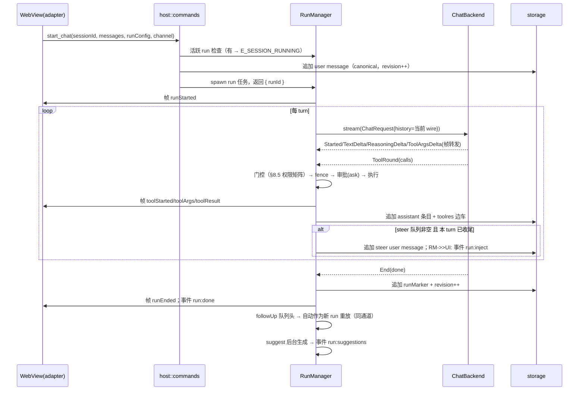
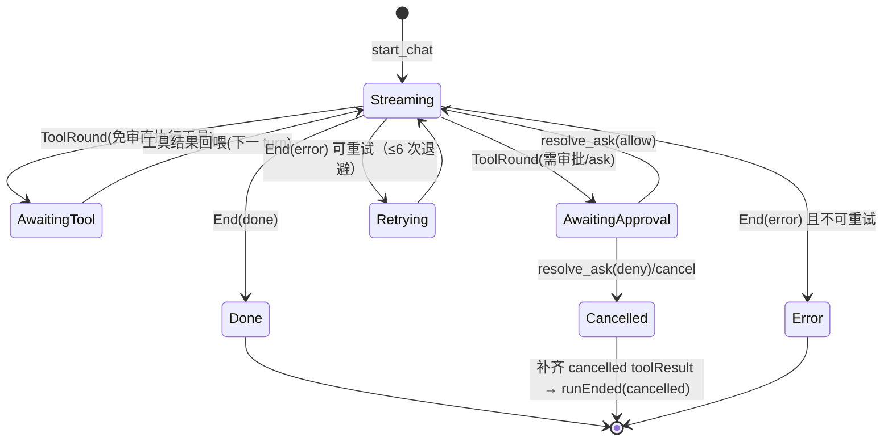
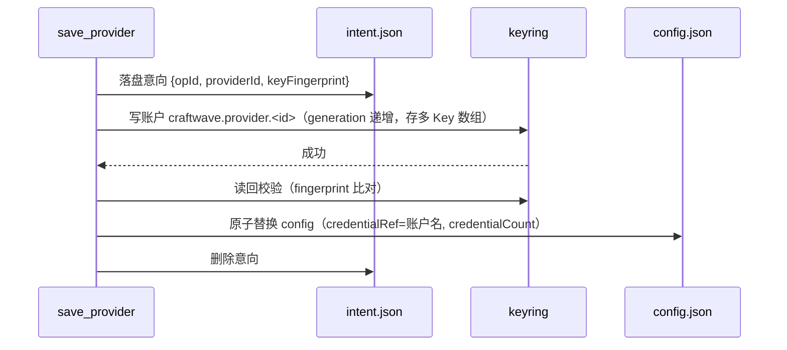

# CraftWave 技术设计文档

| 项 | 内容 |
|---|---|
| 产品名称 | CraftWave —— 本地优先的跨平台桌面 AI Agent |
| 文档版本 | v1.0（M0+M1 范围完整版；P1 详设于 M2 前出 v0.2 增量） |
| 日期 | 2026-10-27 |
| 上游文档 | 《功能需求文档.md》v1.0（PRD）、《数据存储调研.md》v1.0 |
| 技术基线 | Tauri 2 · rig 0.46.x（锁定，见 §4.4）· assistant-ui 0.15.x · React 19 · TypeScript 5.x · Tailwind v4 · zustand 5 · tokio（Tauri 内置） |
| 详细度约定 | 契约与数据格式=字段级；核心算法=伪代码/规则级；交互=时序图/状态机；UI=组件规格级。不含实现代码与视觉稿 |

---

## 目录

- [1. 文档说明](#1-文档说明)
- [2. 系统架构总览](#2-系统架构总览)
- [3. IPC 契约（字段级）](#3-ipc-契约字段级)
- [4. rig 防腐层](#4-rig-防腐层)
- [5. Agent 运行时](#5-agent-运行时)
- [6. 消息模型与分支映射](#6-消息模型与分支映射)
- [7. 存储落地](#7-存储落地)
- [8. 工具系统](#8-工具系统)
- [9. 安全设计](#9-安全设计)
- [10. 前端架构](#10-前端架构)
- [11. Provider 适配层](#11-provider-适配层)
- [12. 测试与 CI](#12-测试与-ci)
- [13. 架构决策记录（D9–D15）](#13-架构决策记录d9d15)
- [附录 A：M0 Spike 验证点](#附录-am0-spike-验证点)
- [附录 B：P0 需求可追溯矩阵](#附录-bp0-需求可追溯矩阵)
- [附录 C：未决问题清单](#附录-c未决问题清单)

---

## 1. 文档说明

### 1.1 定位

本文档回答 PRD（v1.0）中 P0（M0+M1）需求的"怎么做"，是开发、评审与测试编码工作的直接依据。P1 需求中已涉及架构骨架的部分（如 MCP、压缩、子代理）在本文只预留接口与位置，详细设计在 M2 前以 v0.2 增量补齐。

### 1.2 编写与修订规则

- **可追溯性**：每个设计单元标注其实现的 PRD 需求编号（FR-xx-xx / NFR-xx）；完整映射见附录 B。
- **冲突处理**：本文档不得违反 PRD 的验收标准；设计过程中发现 PRD 缺陷时，修订 PRD 并在本文变更记录中注明，不允许绕开。
- **未决问题**：实现层面尚未定论的事项一律记录于附录 C（含建议默认方案），不阻塞其余章节；统一处理后从清单移除并回写正文。
- **自包含**：与 PRD 一致，本文档可脱离参考仓库源码独立交付；涉及上游库（rig/assistant-ui/Tauri）的事实均内嵌描述并标注版本。

### 1.3 术语（增量于 PRD 术语表）

| 术语 | 定义 |
|---|---|
| run / turn / step | run=用户一次发送到最终答复的完整执行；turn=run 内一次模型调用周期（模型输出→工具批→回喂）；step=帧流中的轮次计数（与 turn 同值，用于前端分组） |
| wire 消息 | 发给模型的协议中立消息（role + parts），由会话条目重建 |
| canonical 历史 | Rust 持久化的权威消息序列（会话 JSONL），前端展示树是其超集（分支） |
| 帧序列号 seq | Channel 每帧自增计数，用于对账与去重 |
| session revision | 会话修订号，每次 canonical 追加或树同步成功后 +1，用于乐观并发 |
| 镜像工具 | 前端 defineToolkit 声明的后端工具副本，仅用于渲染与结果桥接，不在前端执行 |

---

## 2. 系统架构总览

### 2.1 进程与运行时模型（实现 FR-13-10 单实例、D1 单进程）

单一 Tauri 2 进程：

- **WebView 进程**（React 应用）：聊天运行态（assistant-ui LocalRuntime）、应用状态（zustand）、IPC 客户端。
- **Rust 主进程**：tokio 多线程运行时（Tauri 内置）。`#[tauri::command]` async 命令运行其上；每个 run 以 `tokio::spawn` 独立任务执行，通过 `CancellationToken` 取消。
- 单实例互斥：tauri-plugin-single-instance，二次启动向既有实例转发 `activate_and_show`。
- 窗口与启动（FR-13-04、NFR-01）：自绘标题栏（tauri-plugin-decoration，顶栏即标题栏；兼容性风险见附录 C-7）；窗口 `visible:false` 启动防闪 + 5s 亮窗看门狗；冷启动预算分解——Rust 侧仅读 config + index.json（<50ms 量级），首屏只加载当前会话历史，历史加载异步于首帧渲染。
- 关闭到托盘：主窗口 close 请求拦截 → 隐藏窗口继续运行（后台运行语义，FR-13-06/07）；存在活跃 run 时经 `app:exit_requested` 事件 + `resolve_exit_request` 命令确认后退出。

### 2.2 Rust 模块划分（D9：M1 单 crate 模块化单体）

```
src-tauri/src/
├── main.rs / lib.rs        # Tauri builder、插件注册、命令注册表
├── host/                   # IPC 层：命令实现（校验/转调）、事件汇、通知、托盘、菜单、退出拦截
│   ├── commands/           # 按域分文件：system/config/provider/project/session/workspace/toolres/ui_state
│   ├── events.rs           # 事件键常量 + emit 封装（供契约测试扫描）
│   └── notify.rs           # 系统通知（三平台）+ notify:activate 回跳
├── agent/                  # 运行时：RunManager、run 状态机、steer/followUp 队列、对账快照
├── backend/                # rig 防腐层：中立 trait + RigAgentBackend + ScriptedBackend(测试)
├── providers/              # 供应商解析（CW schema v2 → rig Model）、Key 池、错误分类
├── tools/                  # 工具注册表 + 各工具实现（read/edit/command/…）+ 批次调度
├── safety/                 # 权限档过滤、审批门、命令围栏(fence)、safe_join、删除守卫、SSRF(P1)
├── storage/                # 会话 JSONL、索引、配置协调器、原子写、toolres 边车、UI 状态
├── knowledge/              # 系统提示组装器（M1：核心提示+权限档块+项目指令）；skills/memory P1
└── util/                   # atomic.rs（原子写）、ids、time、test_support
```

模块依赖方向单向：`host → agent → backend/tools/providers → safety/storage`；`tools` 与 `agent` 互相只通过接口（ToolRegistry）交互。M1 不拆 workspace 多 crate（编译时长与重构成本不划算），crate 边界以模块纪律代替，1.x 若需要再物理拆分。

### 2.3 数据流总览

```
用户发送 → Composer → ChatModelAdapter.run()
  → invoke("start_chat", {sessionId, messages, runConfig, channel})
    → RunManager 启动 run 任务：
        组装(权限档工具集 + 系统提示 + 历史重建) → RigAgentBackend.stream()
        事件流 → 帧节流(64ms) → channel.send(ChatFrame)
        工具轮 → fence/审批门(ask) → 工具执行 → toolres 边车 + canonical 追加
        终态 → runEnded 帧 + run:done 事件 + 建议生成(suggest)
  ← 前端：帧 → assistant-ui parts 累积 yield / runMetrics store / 工具卡片桥接
```

### 2.4 前端目录结构

```
ui/src/
├── app/                    # 路由壳、三栏布局、主题 Provider、i18n 接入
├── ipc/                    # client.ts（唯一 invoke 出口）、types.ts（与 Rust 契约镜像）、events.ts（事件绑定）
├── chat/                   # assistant-ui 接入：runtime.ts(adapter)、toolkit/(镜像工具+卡片)、
│                           #   parts/(run 标记/折叠渲染)、Thread/Composer 组装
├── composer/               # ghost-hint.tsx、token-bar.tsx、permission-tier.tsx
├── panels/                 # 左栏会话树、右栏 Inspector（M1：用量+会话信息；产物/计划 P1 入驻）
├── ask/                    # AskPanel（询问/审批覆盖层）
├── stores/                 # sessions/settings/runMetrics/askHint（zustand）
└── i18n/ theme/            # zh-CN/en-US 资源；主题 token（Tailwind v4 CSS 变量）
```

---

## 3. IPC 契约（字段级）

> 实现 PRD §3.3 三通道与附录 D；本节是其 P0 切片的字段级展开。契约测试见 §12.3。

### 3.1 通用约定（D14）

| 约定 | 内容 |
|---|---|
| 命令名 | snake_case，与 Rust `#[tauri::command]` 函数名一致（如 `invoke("start_chat")`） |
| 负载字段 | 一律 camelCase：Rust 结构体 `#[serde(rename_all = "camelCase")]`；TS 接口 camelCase；TS 类型经 `ipc/types.ts` 手工镜像（生成器见附录 C-2） |
| 可选字段 | 显式 `?` / `Option`，无 null 满字段；时间戳 epoch 毫秒 int64（TS number，JSON 序列化位数足够） |
| 错误 | 命令失败统一 reject `{ code: string, message: string, detail?: unknown }`；code 全集见 §3.6 |
| Channel | `tauri::ipc::Channel<ChatFrame>`，Rust 端 `serde` 序列化后发送；帧自带 `seq`（见 ChatFrame 基座） |
| 事件 | `emit_to("main", key, payload)`；payload 均含 `sessionId`（全局事件除外） |

### 3.2 共享类型（TS 定义，Rust 侧逐一镜像）

```ts
// ---- 供应商（CW schema v2，实现 FR-02-01/06/07）----
interface ProviderConfig {
  id: string;                    // uuid
  name: string;
  apiFormat: "openai_chat" | "anthropic_messages" | "openai_responses";
  baseUrl?: string;              // 缺省按 apiFormat 用官方缺省地址
  credentialRef?: string;        // keyring 账户引用；config 永不存明文 Key
  credentialCount: number;       // 展示用 Key 数量
  models: ProviderModel[];
  headers?: Record<string, string>;
}
interface ProviderModel {
  id: string;                    // uuid，activeModelId 指向它
  model: string;                 // wire id，即显示名
  maxTokens: number;             // default 32768
  contextWindow: number;         // default 128000
  reasoningEffort?: "default" | "low" | "medium" | "high" | "max";
  vision?: boolean;
}

// ---- 应用配置（实现 FR-14）----
interface AppConfig {
  schemaVersion: 2;
  providers: ProviderConfig[];
  activeModelId?: string;
  proxy?: { mode: "none" | "system" | "manual"; url?: string };
  approval: { enabled: boolean; autoConfirm: boolean; commandAllowlist: string[] };
  ui: { language: "zh-CN" | "en-US"; theme: "light" | "dark" | "system"; aiLanguage?: string };
  log: { level: "debug" | "info" | "warn" | "error" };
}

// ---- 项目与会话（实现 FR-10-01、FR-01-01/02）----
interface ProjectMeta { id: string; name: string; homeDir: string; createdAt: number; }
interface SessionMeta {
  id: string; projectId?: string;      // 无 = 临时会话
  title: string; createdAt: number; updatedAt: number;
  revision: number;                    // 乐观并发（§6.4）
  messageCount: number; totalTokens: number;
}

// ---- 消息（wire 中立格式，D8 载体）----
type WireMessage = {
  id: string; parentId?: string;       // 树结构；分支见 §6
  role: "user" | "assistant" | "system";
  parts: WirePart[]; createdAt: number;
};
type WirePart =
  | { type: "text"; text: string }
  | { type: "reasoning"; text: string }
  | { type: "toolCall"; callId: string; name: string; argsJson: string }
  | { type: "toolResult"; callId: string; ok: boolean; summary: string }
  | { type: "planSnapshot"; items: PlanItem[] }
  | { type: "runMarker"; runId: string; startedAt: number; endedAt?: number;
      durationMs?: number; toolCount?: number };

interface PlanItem { id: string; text: string; status: "pending" | "in_progress" | "completed"; }

// ---- 运行配置与快照（实现 FR-03-01/08、FR-05-01）----
interface RunConfig {
  modelId?: string;                    // 会话级覆盖；缺省全局 active
  tier: "plan" | "confirm_each" | "auto_edit" | "full_access";
  maxTurns: number;                    // default 24
  steer: boolean;                      // 本次发送是否为 steer 注入（true 时不新建 run）
}
interface UsageTotal { input: number; output: number; cacheRead: number; cacheWrite: number; }
interface RunSnapshot {                // session_run_snapshot 返回；对账用（FR-03-08）
  status: "idle" | "running";
  runId?: string; startedAt?: number; turn?: number; toolCount?: number;
  usage: UsageTotal; lastSeq: number;  // lastSeq=已发出最大帧序号
}

// ---- 询问/审批（实现 FR-05-02/03/04）----
type AskPayload =
  | { kind: "question"; title: string;
      questions: { id: string; text: string; options?: { id: string; label: string }[];
                   allowFreeText: boolean }[] }
  | { kind: "approval"; title: string;
      diff?: { path: string; hunks: { header: string; lines: { kind: "add" | "del" | "ctx"; text: string }[] }[] };
      command?: string; fenceReason?: string;
      options: { id: string; label: string; recommended?: boolean;
                 mode?: "allow_once" | "always_session" | "deny" }[] };
type AskAnswer =
  | { kind: "question"; answers: Record<string, string> }   // qid -> 选项 id 或自由文本
  | { kind: "approval"; optionId: string; editedCommand?: string };
```

### 3.3 命令注册表（P0 全集 31 个 + P1 预留 6 席）

| # | 命令 | 参数 → 返回 | 说明 |
|---|---|---|---|
| 1 | `ping` | `{}` → `{ pong: true, version: string }` | 连通性 |
| 2 | `app_version` | `{}` → `string` | 版本号 |
| 3 | `open_dir` | `{ path: string }` → `void` | 系统打开目录（校验在 roots/数据目录白名单内） |
| 4 | `open_url` | `{ url: string }` → `void` | 系统 https 打开 |
| 5 | `select_dir` | `{}` → `string \| null` | 原生目录选择 |
| 6 | `get_config` | `{}` → `AppConfig` | |
| 7 | `save_config` | `{ config: AppConfig }` → `AppConfig` | 经配置协调器（§7.6）原子落盘，返回归一化结果 |
| 8 | `save_provider` | `{ provider: ProviderConfig, newKey?: string }` → `ProviderConfig` | newKey 存 keyring 后仅落引用（§9.6 协议） |
| 9 | `delete_provider` | `{ providerId: string }` → `void` | 同步删除 keyring 账户 |
| 10 | `list_projects` | `{}` → `ProjectMeta[]` | |
| 11 | `save_project` | `{ project: { id?: string; name: string; homeDir: string } }` → `ProjectMeta` | 新建/更新；homeDir 变更触发数据目录重绑 |
| 12 | `delete_project` | `{ projectId: string }` → `void` | 不删除项目数据目录 |
| 13 | `create_session` | `{ projectId?: string }` → `SessionMeta` | 项目会话固化 roots 快照 |
| 14 | `list_sessions` | `{ projectId?: string }` → `SessionMeta[]` | 按 updatedAt 倒序 |
| 15 | `load_session` | `{ sessionId: string }` → `SessionData` | `SessionData = { meta, messages: WireMessage[], activeLeafId?: string }`；全量（分页 P2） |
| 16 | `delete_session` | `{ sessionId: string }` → `void` | 运行中拒绝（E_SESSION_RUNNING） |
| 17 | `rename_session` | `{ sessionId, title }` → `SessionMeta` | |
| 18 | `start_chat` | `{ sessionId, messages: WireMessage[], runConfig: RunConfig, channel }` → `{ runId: string }` | 详 §5.2；同会话已有 run → E_SESSION_RUNNING（steer 走 21） |
| 19 | `cancel_run` | `{ sessionId: string }` → `boolean` | CancellationToken 置位即返回 true |
| 20 | `session_run_snapshot` | `{ sessionId }` → `RunSnapshot \| null` | 对账（§5.6） |
| 21 | `inject_run_message` | `{ sessionId, text: string }` → `{ queued: boolean }` | queued=true=steer 已被运行中 run 接纳；false=无活跃 run（M1 前端收到 false 转为普通 start_chat 发送，§5.5） |
| 22 | `resolve_ask` | `{ askId: string, answer: AskAnswer }` → `void` | 超时/取消返回 E_NOT_FOUND |
| 23 | `resolve_exit_request` | `{ accepted: boolean }` → `void` | 退出确认（FR-13-06） |
| 24 | `get_session_prefs` | `{ sessionId }` → `{ modelId?: string }` | |
| 25 | `set_session_prefs` | `{ sessionId, prefs: { modelId?: string } }` → `void` | 权限档不持久化（PRD FR-14-05） |
| 26 | `save_session_tree` | `{ sessionId, messages: WireMessage[], activeLeafId?: string, baseRevision: number }` → `{ revision: number }` | 分支同步（§6.4）；指纹校验失败 E_SESSION_REV |
| 27 | `search_workspace_paths` | `{ sessionId, query: string, limit?: number }` → `{ path: string; kind: "file"\|"dir" }[]` | @ 引用补全（FR-09-05） |
| 28 | `read_workspace_file` | `{ sessionId, path: string, range?: { offset: number; limit: number } }` → `{ content: string; truncated: boolean }` | 预览读取（roots 内校验） |
| 29 | `load_tool_outcomes` | `{ sessionId, callIds: string[] }` → `Record<string, ToolOutcomeJson>` | 工具卡恢复（FR-04-07） |
| 30 | `get_ui_state` | `{}` → `unknown`（Json 原样） | |
| 31 | `set_ui_state` | `{ state: unknown }` → `void` | 防抖由前端负责 |
| 32–37 | （P1 预留，v0.2 展开） | | `test_provider`、`mcp_*`、`git_*`、`stats_*`、`logs_*`、外部目录授权 |

`ToolOutcomeJson = { ok: boolean; data?: unknown; error?: string; uiSummary: string; detail?: unknown }`。

### 3.4 Channel 帧定义（ChatFrame，P0 全集 9 种）

```
帧基座：所有帧先序列化为 { seq: number, type: string, ...字段 }（seq 由 Rust 端 RunHandle 递增）

runStarted   { seq, type:"runStarted", runId, model: string }            // model=显示名
stepStarted  { seq, type:"stepStarted", turn: number }                    // turn 从 1 起
textDelta    { seq, type:"textDelta", turn, delta: string }
reasoningDelta { seq, type:"reasoningDelta", turn, delta: string }
toolStarted  { seq, type:"toolStarted", callId, name: string }
toolArgs     { seq, type:"toolArgs", callId, chunk: string }              // 参数增量 JSON 片段
toolResult   { seq, type:"toolResult", callId, ok, uiSummary: string,
               error?: { code: string; message: string } }
usage        { seq, type:"usage", usage: UsageTotal, rate?: number }      // rate=输出 tok/s（FR-01-13）
runEnded     { seq, type:"runEnded", reason: "done"|"error"|"cancelled",
               durationMs: number, toolCount: number, turn: number,
               error?: { code: string; message: string } }
```

排序规则：Rust 端保证 seq 严格递增且与发送顺序一致；toolResult 必晚于同 callId 的全部 toolArgs。P1 帧（toolProgress、sub*、compaction）v0.2 定义，帧 type 命名空间已预留。

### 3.5 事件定义（P0 全集 18 键）

| 键 | payload | 触发时机 |
|---|---|---|
| `run:start` | `{ sessionId, runId }` | run 任务确认启动 |
| `run:done` | `{ sessionId, runId, durationMs }` | 正常终态 |
| `run:error` | `{ sessionId, runId, code, message }` | 异常终态 |
| `run:cancelled` | `{ sessionId, runId }` | 用户取消 |
| `run:retry` | `{ sessionId, runId, attempt, code }` | 可恢复错误自动重试 |
| `run:inject` | `{ sessionId, runId, acceptedAtTurn?: number }` | steer 被消费（checkpoint 后回执） |
| `run:suggestions` | `{ sessionId, runId, text: string }` | suggest 生成完成（FR-06-09） |
| `tool:start` / `tool:result` / `tool:error` | `{ sessionId, runId, callId, name?, ok?, code? }` | 跨 Tab 监听用（帧的镜像） |
| `plan:update` | `{ sessionId, items: PlanItem[] }` | plan 工具变更 |
| `tokens:update` | `{ sessionId, usage: UsageTotal }` | 会话累计（FR-01-13 会话口径） |
| `ask:opened` | `{ sessionId, askId, payload: AskPayload }` | 询问/审批开启（AskPanel 弹出） |
| `ask:closed` | `{ askId, answered: boolean }` | 已答/已取消 |
| `session:title` | `{ sessionId, title }` | 自动标题（FR-01-09，P1 实装、键位 M0 定死） |
| `notify:activate` | `{ sessionId, runId?, anchor?: { kind: "ask" \| "runEnd"; ref?: string } }` | 系统通知点击回跳 |
| `menu:action` | `{ action: "settings" \| "about" \| "check_update" }` | macOS 原生菜单 |
| `app:exit_requested` | `{ hasActiveRuns: boolean }` | 托盘/关闭退出且有活跃 run |

### 3.6 错误码注册表

| code | 域 | 语义 |
|---|---|---|
| E_INVALID_ARG | 通用 | 参数校验失败 |
| E_NOT_FOUND | 通用 | 目标不存在 |
| E_INTERNAL_STATE | 安全 | 试图写宿主内部状态（FR-05-08） |
| E_SESSION_RUNNING | 会话 | 会话已有活跃 run |
| E_SESSION_REV | 会话 | 树同步基线过期（§6.4） |
| E_CANCELLED | 会话 | 操作被取消 |
| E_PROVIDER_AUTH / E_PROVIDER_BILLING / E_PROVIDER_RATE_LIMITED / E_PROVIDER_BAD_REQUEST / E_PROVIDER_SERVER / E_PROVIDER_PROTOCOL / E_PROVIDER_NETWORK | 供应商 | 七类（FR-03-04），auth/billing 不自动重试 |
| E_KEYRING | 凭据 | 钥匙串读写失败 |
| E_PATH_OUTSIDE_ROOTS | 安全 | 路径越界（FR-05-06） |
| E_DELETE_GUARDED | 安全 | 删除守卫命中 |
| E_FENCE_BLOCKED | 安全 | 命令围栏 Block（FR-05-05） |
| E_TOOL_BLOCKED | 工具 | 权限档排除（FR-05-01） |
| E_PLAN_STALE | 计划 | 已批准计划过期仍写（FR-06-02 默认策略） |
| E_PLAN_REQUIRED | 计划 | 严格硬门开启时空计划写（默认关，§8.6） |
| E_EDIT_NO_MATCH / E_EDIT_AMBIGUOUS / E_EDIT_VERSION_STALE | edit | 匹配失败/多命中/版本过期（§8.4） |
| E_RUN_STALLED | 运行时 | 流停滞看门狗（P1 实装、码位定死） |

---

## 4. rig 防腐层

### 4.1 目标（实现 D6、风险 R1）

业务代码（agent/tools/providers 之外）不 import rig 具体类型；rig 升级只改 `backend/rig_impl.rs` 与 `providers/` 两处。

### 4.2 中立接口

```rust
// backend/mod.rs —— 业务侧唯一可见的类型
pub enum BackendEvent {
    Started { model: String },
    TextDelta(String),
    ReasoningDelta(String),
    ToolArgsDelta { call_id: String, name: String, chunk: String },
    ToolRound(Vec<ToolInvocation>),        // 本 turn 全部调用解析完毕（参数 JSON 完整）
    Usage(UsageTotal),
    End { reason: EndReason; error: Option<BackendError> },
}
pub struct ChatRequest {                   // 一次 run 的完整输入
    pub model: ResolvedModel,              // §11.1
    pub system: String,                    // knowledge 组装结果
    pub history: Vec<WireMessage>,         // wire 中立
    pub tools: Vec<ToolSpec>,              // 权限档过滤后的全集
    pub max_turns: u32,
}
pub trait ChatBackend: Send + Sync {
    fn stream(&self, req: ChatRequest) -> BoxStream<'static, anyhow::Result<BackendEvent>>;
}
```

### 4.3 两个实现

- **RigAgentBackend**：把 ChatRequest 映射为 rig `AgentBuilder`（preamble=system、动态工具经 `DynamicTool` 桥接 `ToolInvocation`、history 转换）+ `AgentRunner.prompt(...).stream()`；`MultiTurnStreamItem` → `BackendEvent` 逐项映射（StreamAssistantItem 文本/推理→Delta；工具参数增量→ToolArgsDelta；ToolCall→ToolRound）。审批暂停/工具执行**不在 backend 做**（RunLoop 负责，见 §5.4），backend 以回调 `ToolRound` 交还控制权——这要求 rig 侧重用"手动工具循环"模式（rig `manual_tool_calls` 示例路线：backend 每次只跑一个 model turn，工具循环由 RunLoop 驱动）。确证点见附录 A Spike S3。
- **ScriptedBackend**：按脚本回放 BackendEvent 序列，供全部 agent 层单测/集成测试使用（无网络、确定性、毫秒级）。

### 4.4 版本与升级策略

- 锁定 `rig = "=0.46.x"`（若 Spike 判定 rc 不稳则锁 0.45 稳定版，二者 API 均只触达 `backend/rig_impl.rs`）。
- 升级流程：单独 PR → ScriptedBackend 全量回归 + 真实 provider 冒烟（人工）→ 合并；MIGRATING.md 为必读清单。

---

## 5. Agent 运行时

### 5.1 RunManager

```rust
pub struct RunManager { runs: DashMap<SessionId, Arc<RunHandle>> }
pub struct RunHandle {
    pub run_id: RunId,
    pub cancel: CancellationToken,
    pub state: Mutex<RunState>,        // 快照可读
    pub frames: Channel<ChatFrame>,   // run 生命期内有效
    pub seq: AtomicU64,
    pub steer_tx: mpsc::Sender<SteerMsg>,   // 容量 32
    pub ask: Mutex<Option<AskSlot>>,       // 当前未决 ask（oneshot 回执）
}
pub struct RunState { status, started_at, turn, tool_count, usage, last_seq, plan: Option<PlanState> }
```

### 5.2 start_chat 命令流程（时序）



### 5.3 run 状态机（FR-03-01/02/03/06）



不变量：终态前三件事必做——取消中工具收齐（补 `E_CANCELLED` 结果）、canonical 追加 runMarker、快照 status 置 idle。取消传播：`cancel_run` 置 CancellationToken → backend 流 drop + 工具任务 abort（进程组收割，§8.3）。

### 5.4 工具门控与执行（RunLoop 内）

每个 ToolRound：① 权限档排除（E_TOOL_BLOCKED 帧内标记，不中断 run）→ ② 同批写路径冲突检测（重复即后一个拒绝）→ ③ fence（command 专属，Allow/Confirm/Block）→ ④ 审批门（confirm_each 档的写类/网络类，或 fence=Confirm）→ ⑤ 执行（文件写全局串行队列，其余并发≤4）→ ⑥ 双通道结果（帧 toolResult + toolres 边车落盘）→ ⑦ 模型侧 compact 文本回喂（§8.2）。审批实现：RunLoop 挂起该工具的 oneshot，`ask:opened` 事件携带 AskPayload；AskPanel 应答 → `resolve_ask` → oneshot 唤醒。默认无限等待；autoConfirm 开启时 300s 超时自动选 recommended 项（灾难级除外）。

### 5.5 steer / followUp（FR-01-07）

- 运行中 `inject_run_message`：入 `steer_tx`；消费点=turn 边界（工具批结果回喂后、下一次 model 调用前）——追加 user 条目并注入下一请求；回执 `run:inject{acceptedAtTurn}`。带图消息（P1）不入 steer，进 followUp。
- run 结束后 `inject_run_message`：进会话级 followUp Vec；run 终态处理完队列头自动新开 run（同 channel 复用由前端重新 start_chat 实现——M1 简化：前端在收到 runEnded 且有待发队列时自行重新调用 start_chat；后端队列仅存续于 run 生命期。见附录 C-3）。
- 取消 run：队列内容随 run 终结丢弃（前端草稿区返还展示）。

### 5.6 对账协议（FR-03-08，NFR-07）

- 前端持有 runEpoch：每次收到帧 seq 必须 > 已见最大 seq，否则丢弃；缺口（seq 跳跃）触发 `session_run_snapshot` 拉取。
- runEnded 帧丢失兜底：前端 5s 未收到新帧且快照 status=idle → 调 `load_session` 重载 canonical 终态。
- WebView 重载（channel 失效）：快照显示 running → M1 渲染只读"运行中"态，run 由 Rust 继续执行并持久化，结束后用户刷新/重进会话看到结果（限制记录于附录 C-1）。

---

## 6. 消息模型与分支映射

### 6.1 存储条目（会话 JSONL 每行一个，serde tag=kind）

```
{"kind":"session","v":1,"id","projectId?","createdAt"}
{"kind":"message","id","parentId?","role","parts":[WirePart…],"createdAt","runId?"}
{"kind":"meta","activeLeafId?","title?","revision"}        // 段尾/事件后追加的轻量元数据行
```

追加规则（继承 rig-session/4 与 CW 分段纪律，详见 §7.2–7.4）：message 条目**内容不可变**——编辑/重生成/分支一律追加新节点（新 id、复用 parentId），永不修改既有行。

### 6.2 wire 重建（canonical → 模型输入）

按 activeLeafId 所在路径从根到叶收集节点，展开 parts：text/reasoning 原样；toolCall+toolResult 配对合并为模型工具消息；planSnapshot → 系统注入当前计划；runMarker 跳过；compaction 边界（P1）之前仅注入摘要。临时会话 roots=全局数据目录。

### 6.3 前端树 ↔ ExportedMessageRepository（D8）

- 加载：`load_session` 返回全量 messages + activeLeafId → 前端转为 assistant-ui 导出格式（节点 {id, parentId, message} 映射一一对应）→ 作为 `initialMessages` 传入 `useLocalRuntime`。
- 运行中：LocalRuntime 自动维护树；adapter 每次 yield 增量更新叶节点。
- 运行结束/分支操作后（编辑重发、重生成、切换分支）：前端调用 `save_session_tree(messages, activeLeafId, baseRevision)` 全量同步——Rust 校验既有 id 的内容哈希不变（变则 E_SESSION_REV），仅追加缺失节点（按父先子后拓扑序），更新 activeLeafId 与 revision。
- Rust canonical 追加（start_chat 的 user、run 产物）与前端树同步双写冲突：canonical 追加总是先发生且 revision++；前端以最新 revision 为 base 同步，永不覆盖只追加 → 无冲突路径。精确的 assistant-ui 导出结构以安装版本为准（Spike S4 钉死，附录 C-4）。

### 6.4 修订号与并发

revision 单调递增，存于 session meta 行与 index.json。`save_session_tree` 校验 baseRevision == 当前值；不等返回 E_SESSION_REV，前端重载后重试（分支冲突极少见：单用户单实例）。

---

## 7. 存储落地（实现 D7、NFR-06/21）

### 7.1 目录布局（M1 实际使用的子集）

```
~/.craftwave/
├── config.json                 # AppConfig（schema v2，CW 兼容字段）
├── projects/directories.json   # {version:1, projects:[{id,name,homeDir}]}
├── sessions/index.json         # {version:1, sessions:[SessionMeta]}（≤2000 条，超限归档最旧）
├── histories/<sessionId>/
│   ├── 0001.jsonl …            # 分段会话日志（§7.2）
│   └── .segmeta.json           # {segments:[{file,count,bytes,headHash}], headFingerprint}
├── sessions/<sessionId>.prefs.json
├── sessions/<sessionId>.toolres/<callId>.json
├── ui-state.json
├── logs/
└── cache/                      # M2 起存放 index.db（本次不创建，D13）
<项目主目录>/.craftwave/
└── project.json                # {id,name,homeDir,rootsSnapshot,createdAt}
```

### 7.2 分段与封口

- 段封口条件（仅在安全点检查：run 终态后、ask 关闭后）：条目数 ≥200 或字节数 ≥512KB。
- 封口时写 `.segmeta.json`（段清单 + 每段 head 条目哈希）；恢复时校验 headFingerprint：不匹配只新增新段、绝不截断既有段。
- 每段文件内条目按追加序线性排列；段内禁止拆分同一 run 的 message 组（安全点机制保证）。

### 7.3 持久化时机与 fsync 策略（NFR-06 解释）

| 事件 | 持久化动作 | fsync |
|---|---|---|
| start_chat user 消息 | 追加 message 条目 | 是 |
| 每个工具结果 | 追加 toolResult part 所属 assistant 条目（逐 turn 落）+ toolres 边车 | 是 |
| turn 文本完成 | 追加该 turn assistant 条目（文本在 turn 内仅内存，turn 结束一次落盘） | 是 |
| run 终态 | 追加 runMarker + meta(revision) + index 更新 | 是 |
| 文本流中途崩溃 | 该 turn 未提交 → 重启后该 run 标记 interrupted（无半行） | — |

**NFR-06 的实现口径**：已提交（上表落盘点）历史零丢失；进行中 run 的未完成 turn 不入史、重启标记 interrupted——这是有意设计而非缺陷。

### 7.4 原子写与锁（util/atomic.rs、storage）

- 所有整文件（config/index/prefs/ui-state/segmeta）写法：临时文件同目录 + `fsync` + rename（Windows `MoveFileExW MOVEFILE_REPLACE_EXISTING`）。
- 进程内锁：`MutexMap<SessionId>` 串行化同会话存储操作；全局 `index_lock` 在会话锁内获取（锁序：session → index，禁止逆序）。
- M1 单进程 + 单实例插件 → 无跨进程写并发；跨进程写锁（CW FileCoordinator）留 1.x。

### 7.5 toolres 边车与恢复

`ToolOutcomeJson` 全量写 `<callId>.json`；`load_tool_outcomes` 批量返回。卡片恢复：前端渲染历史 toolCall part 时按 callId 拉取。GC：会话删除时随目录删除；单文件超过 5MB 拒绝入边车（引用 spill 文件路径代替）。

### 7.6 配置协调器（FR-14-03）

写 config 流程：入参校验/归一化 →（涉 newKey 时先走 §9.6 钥匙串协议）→ 临时文件写入 → fsync → rename → 内存缓存热替换 → 返回归一化结果。意向日志（intent.json）在钥匙串步骤前落盘，成功后删除；崩溃后重启发现意向日志则提示用户重试（不自动重放写操作）。

### 7.7 派生索引库（M2，v0.2 详设）

D13：M1 不创建 index.db——FTS 搜索（P2）、统计聚合（P1）、RAG（P2）全部推迟；布局已在 `cache/` 预留。DDL、重建与降级流程 v0.2 按《数据存储调研.md》§5.3 展开。

---

## 8. 工具系统

### 8.1 契约与注册表（FR-04-01）

```rust
pub struct ToolSpec {
    pub name: &'static str,               // 合法字符 [a-z_][a-z0-9_]{0,63}
    pub description: String,              // 面向模型，≤800 字符
    pub capability: Capability,           // ReadOnly | FileWrite | Network | Interactive | Meta
    pub params_schema: serde_json::Value, // schemars 生成，additionalProperties:false
    pub annotations: ToolAnnotations,     // readOnlyHint 等（镜像 MCP annotations）
}
```

注册表：静态 Vec + 启动时构建（MCP 动态工具 P1 并入 `ToolServer` 模式）。集成测试钉死名称清单与顺序（防漂移）。**三处同源过滤**（FR-05-01）：生成 ChatRequest.tools、RunLoop 门控、（P1）子代理边界，共用 `fn filter_for_tier(specs, tier) -> Vec<ToolSpec>` 一个实现。

### 8.2 双通道结果（FR-04-03）

- UI 通道：toolres 边车全量 JSON + 帧 uiSummary（一行人话）。
- 模型通道：compact 文本（成功：序列化 data，头 4KB + 尾 8KB 截断；失败：error code+message）。**要求模型据此行动的结论必须写入 data**；warnings 字段仅 UI 显示不进模型文本。

### 8.3 P0 工具清单（9 个）

| 工具 | 能力 | 参数 schema 摘要 | 结果要点 |
|---|---|---|---|
| `read` | ReadOnly | `{path, offset?, limit?, kind:"text"\|"image"}` | 文本按行窗口（默认 2000 行）；图片 base64（≤3MiB，vision 模型前置校验）；PDF>10 页须显式页码 |
| `write` | FileWrite | `{path, content}` | 新建；已存在拒绝（E_INVALID_ARG）→ 引导用 edit |
| `edit` | FileWrite | `{path, oldText, newText, version?}` | 算法 §8.4；结果含 lineChanges{add,del} |
| `list_files` | ReadOnly | `{path?, depth?, respectGitignore:true}` | 树形清单，上限 500 条目 |
| `grep` | ReadOnly | `{pattern, path?, glob?, maxResults?}` | 内嵌 ripgrep（grep-regex+searcher+ignore）；命中行上下文 ±0 |
| `command` | Network* | `{command, timeoutSec?, cwd?}` | *能力标 Network 以走围栏+审批；超时 1–600s 默认 120；ANSI 清洗；>96KB spill 落盘（24h 清理）；进程组/Job Object 收割 |
| `plan` | Meta | `{action:"set"\|"update", items?:[{id,text,status}]}` | ≤100 项、单 in_progress；事件 plan:update；批准态见 §8.6 |
| `ask` | Interactive | `{title, questions:[…]}` | ask:opened/closed；answer 回喂为工具结果 |
| `suggest` | Meta | `{text}` | 仅 run 尾调用（RunLoop 收尾阶段，非模型主动）；事件 run:suggestions |

### 8.4 edit 算法（伪代码，FR-04 表 edit 行）

```
输入：path, oldText, newText, version?(sha256(原文件字节)前16hex)
1. safe_join(path) → 越界 E_PATH_OUTSIDE_ROOTS
2. 读原文件 bytes；version 给定且不匹配 → E_EDIT_VERSION_STALE（若仍可唯一匹配则降级为警告执行，结果标注）
3. 匹配 oldText（三级，每级仅接受唯一命中，绝不猜）：
   L1 精确字节匹配
   L2 整块缩进平移：oldText 整体去掉公共缩进后在全文按行试每种缩进回填
   L3 逐行首尾空白归一匹配（记录映射）
   0 命中 → E_EDIT_NO_MATCH；≥2 命中 → E_EDIT_AMBIGUOUS（模型须补充上下文）
4. 组内预演：同批全部 edit 先算目标态；冲突（同文件多 edit 区间重叠）→ 后者拒绝
5. 提交：备份原文件到 tmp → 按 start 倒序写入全部替换 → fsync → 任一失败回滚整组
6. EOL 保持：检测原文件 CRLF/LF，写回时还原
```

### 8.5 权限 × 工具门控矩阵（FR-05-01/02）

| 工具能力 \ 档位 | plan | confirm_each | auto_edit | full_access |
|---|---|---|---|---|
| ReadOnly | 放行 | 放行 | 放行 | 放行 |
| FileWrite | **过滤**（不出现在 tools） | 审批（diff 预览） | roots 内直写 | 直写 |
| Network | **过滤** | 审批（command 走 fence） | 审批 | fence=Block 仍拦；其余放行 |
| Interactive(ask) | 放行 | 放行 | 放行 | 放行 |
| Meta | 放行 | 放行 | 放行 | 放行 |

灾难级（fence 黑名单、删除守卫命中）任何档位均拦截，autoConfirm 永不生效。MCP（P1）在 plan 档全过滤。

### 8.6 计划门（FR-06-02 默认"有计划即守门"）

- PlanState{items, approvedSnapshot?, approvedAt?}。用户在计划卡点"批准" → 冻结快照。
- 守门规则：approvedSnapshot 存在时，FileWrite/Network 工具执行前校验 items 非全部 completed；全部 completed 仍要写 → E_PLAN_STALE（工具结果回喂提示模型先更新计划）。
- 无 approvedSnapshot → 不阻写（PRD 定稿策略）；严格硬门（E_PLAN_REQUIRED）为设置开关，默认关。

### 8.7 fence v0.1 规则（FR-05-05 P0 部分）

1. 黑名单（正则集，命中即 E_FENCE_BLOCKED）：`rm -rf`、`sudo/su`、`shutdown/reboot`、`mkfs`、`dd of=/dev/`、`curl|wget … | sh/bash`、`git push --force`、`chmod -R 777 /`、`> /dev/sd`、Windows `format/rd /s /q`。
2. plan 档只读白名单：`ls/cat/head/tail/wc/find/rg/grep/git status|diff|log|show/node --version/python --version` 等子命令集。
3. 写信号启发（非 plan 档）：重定向 `>`/`>>`、`tee`、`sed -i`、`npm i/pip install/make/cargo build` 等 → confirm_each 审批；无信号 → 按档位。
4. AST 写目标分析（tree-sitter bash/powershell）为 P1（FR-05-05 P1 部分）；v0.1 明确**不 fail-open**：黑名单或写信号判定异常时按 Confirm 处理。

### 8.8 命令输出治理

超时默认 120s（1–600）；stdout+stderr 合流清洗 ANSI/OSC；>96KB 全量 spill 至 `logs/spill/<callId>.txt`（24h 清理），工具结果只带尾部 16KB + spill 路径；进程组（Unix）/Job Object（Windows）在超时/取消时整树收割。

---

## 9. 安全设计

### 9.1 路径边界 safe_join（FR-05-06）

```
safe_join(roots, path):
  拒绝：空、包含 "\0" 或控制字符、Windows 保留名（CON/PRN/AUX/NUL/COM1…）
  解析为绝对路径（相对路径相对项目主目录）
  规范化后 canonicalize（解析符号链接）
  要求 canonical 前缀 ∈ roots 的 canonical 集合（roots = 项目主目录 + 数据目录 + M1: 无 extra_roots）
  命中即通过；否则 E_PATH_OUTSIDE_ROOTS
  full_access 不解除本检查
```

删除守卫（delete 工具 P1，write 覆盖语义复用）：目标 canonical 为 文件系统根/家目录本身/.git/系统目录（/System32、/usr 等）→ E_DELETE_GUARDED。

### 9.2 SSRF 管道（P1 实装，规格先行）

web_fetch/http_request（P1 工具）：DNS 解析 → 全地址校验（拒私网/回环/链路本地/CGNAT 段，`allow_private_network` 设置例外）→ 连接前再校验（防 DNS rebinding）→ 重定向逐跳重校验（≤10 跳、HTTPS 不降级、跨源剥自定义头）→ 每 host 1s 节流 → 正文 ≤50MiB。

### 9.3 宿主内部状态保护（FR-05-08）

受保护区：`~/.craftwave/` 下 config/trust/、`<home>/.craftwave/` 全部、`.segmeta.json`、锁与意向日志。write/edit/command 重定向（>`、`tee`）目标经 safe_join 额外过"受保护区前缀"检查，命中 → E_INTERNAL_STATE（full_access 不豁免）。

### 9.4 keyring 提交协议（FR-05-09，时序）



失败任一步：config 不变更、意向保留、下轮保存重试（opId 幂等去重）。日志永不打印 Key 明文与指纹全文。

### 9.5 Tauri 权限与 CSP（FR-05-14，NFR-10）

```jsonc
// tauri.conf.json（节选）
"csp": "default-src 'self'; script-src 'self'; style-src 'self' 'unsafe-inline';
        img-src 'self' data: blob:; connect-src ipc: http://ipc.localhost https://*;
        font-src 'self'; worker-src 'self' blob:; frame-src 'self' blob:"
// capabilities/default.json（最小集）
core:default, core:window:allow-close/hide/show/set-focus, core:app:default,
core:event:default, clipboard-manager:allow-write-text,
notification:default, tray:default, single-instance:default, updater:default(P1)
```

connect-src 的 `https://*` 仅供前端直接 fetch 的场景（M1 无：所有模型流量在 Rust 侧）；Spike S6 后收紧。

### 9.6 通知与后台运行实现（FR-13-06/07）

- 托盘：tauri tray（图标 + 显示/退出菜单）；窗口 close → hide（close_to_tray 默认 true，设置可改为真退出）。
- 通知触发点（RunLoop）：run 终态失焦时、ask:opened 时；payload 带 anchor；点击 → `notify:activate` → 前端路由到会话并滚动/展开。
- 退出拦截：存在活跃 run 的退出请求 → `app:exit_requested` → 前端确认 → `resolve_exit_request(true)` 才真正退出；托盘"退出"同路径。
- 通知权限：macOS 首次申请 + 未授权引导设置页；Windows AUMID；Linux portal 回退。

---

## 10. 前端架构

### 10.1 状态分界（D5）

| 状态 | 归属 | 持久化 |
|---|---|---|
| 消息树/分支/发送状态 | assistant-ui LocalRuntime | 经 save_session_tree 同步至 Rust |
| 会话列表/当前 Tab | zustand `sessions` | Rust index + ui-state |
| 设置草稿 | zustand `settings` | save_config |
| 运行指标（速率/轮次/会话累计） | zustand `runMetrics`（帧驱动） | 无（重算自 Rust） |
| ask/审批 | zustand `ask`（事件驱动）+ AskPanel | 无 |
| 建议提示词 | zustand `askHint`（run:suggestions 驱动） | 无 |

### 10.2 ChatModelAdapter（核心，官方 Tauri 路径）

```ts
// chat/runtime.ts —— 伪代码级完整设计
const tauriChatModel: ChatModelAdapter = {
  async *run({ messages, runConfig, abortSignal }) {
    const { sessionId } = useSessionStore.getState();
    const channel = new Channel<ChatFrame>();
    const buf = new FrameBuffer();              // 累积器：parts 数组 + runMetrics 转发
    channel.onmessage = (f) => { buf.push(f); runMetrics.ingest(f); };
    const { runId } = await invoke("start_chat", {
      sessionId, messages: toWire(messages), runConfig, channel,
    });
    const abort = () => invoke("cancel_run", { sessionId });   // 不 await
    abortSignal?.addEventListener("abort", abort, { once: true });
    try {
      for await (const snapshot of buf.snapshots()) {          // 64ms 节流快照迭代器
        yield buf.toResult(snapshot);                          // ChatModelRunResult：累计 parts
      }
    } finally {
      abortSignal?.removeEventListener("abort", abort);
      metrics.final(buf.usage);                                 // 计数条定格
    }
  },
};
// toResult：text/reasoning → 对应 part；toolStarted/Args/Result → 镜像工具的
// tool-call part（argsJson 累积，半截 JSON 由 toolkit 卡片以"参数准备中"渲染）；
// runStarted/runEnded → data-runMarker part（折叠分组锚点，见 10.4）
```

助手消息 part 顺序即帧到达顺序；每次 yield 为**全量累计快照**（assistant-ui 语义：替换而非增量）。

### 10.3 镜像工具与卡片（D11）

- `defineToolkit` 声明 9 个 P0 工具（name/参数 schema 与 Rust ToolSpec **同一份来源**：Rust 测试导出 `ipc-manifest.json`，前端测试校验一致性，§12.3）。
- `execute()` 不执行业务：按 callId 注册 pending Promise，FrameBuffer 收到对应 toolResult 帧后 resolve——assistant-ui 原生获得 running→result 状态机与渲染。
- 卡片（每工具一个 React 组件，规格级）：
  - `read`：路径 + 行区间 + 预览展开（首 50 行，读全文调 read_workspace_file）。
  - `write/edit`：unified diff 视图（+N/−N 徽标；edit 用 hunks 结构直接渲染）。
  - `command`：命令行 monospace + 输出折叠（默认尾部 20 行）+ 退出码徽标 + spill 链接。
  - `grep/list_files`：命中计数 + 结果列表（上限展示 100）。
  - `plan`：计划卡（FR-06-01 双呈现：消息内 + 右栏面板，批准按钮冻结快照）。
  - `ask/suggest`：不渲染为卡片（AskPanel/ghost hint 承载）。

### 10.4 折叠分组与总结（FR-01-10）

- runMarker part（runStarted/runEnded 成对）划分消息区；Thread 渲染组件按"当前 runMarker 区间"分组。
- 组内渲染：过程 parts（reasoning/工具卡/计划更新）默认展开（运行中）→ 收到 runEnded data part 后 3s 内收起为摘要行 `⚙ {toolCount} 次工具调用 · {duration}`；区间内**最后一个 stepStarted 的 text parts** 即最终答复（多个 text part 按序拼接为一段），保留在折叠区外常显；更早 turn 的零星 text 归入折叠区。
- 历史加载：runEnded 存在的区间默认收起；点击摘要行展开（过程数据来自持久化 parts + toolres 边车补全）。
- 建议提示词（FR-06-09）：`askHint` store 订阅 run:suggestions → Composer 内 ghost span（输入为空时整句 / 前缀匹配时补尾部）；Tab 优先级：触发符菜单 > hint；接受=填入不发送。

### 10.5 Token 计数条（FR-01-13）

`runMetrics` store 持有 {rate, turnUsage, sessionUsage}：rate=usage 帧 rate 或 TextDelta 窗口自算（TTFT 记首帧时间）；turnUsage 按 runId 清零累计；sessionUsage 以 tokens:update 为准（重启后 load_session 的 SessionMeta.totalTokens 回填）。三个数字常驻 Composer 下方；hover Popover 拉四口径明细（缓存命中率=cacheRead/(input+cacheRead)）、上下文进度条（sessionUsage 折算当前模型 contextWindow，0.6 阈值标线）。

### 10.6 Composer 与输入细节

Enter 发送 / Shift+Enter 换行；Esc 停止运行/关闭浮层；↑↓ 输入框为空时翻阅本人历史消息；IME composition 期间 Enter 不发送（`isComposing` 检查，WKWebView 重点回归）；Shift+Tab 循环权限档（档位仅内存态，重启回 confirm_each）；`@` 触发路径菜单（search_workspace_paths，光标锚定）；草稿按 Tab 存 ui-state。

### 10.7 会话/项目/设置页（组件规格）

- 左栏：临时会话区 + 项目分组会话树（展开/折叠）、新建按钮、搜索框（P1 全文，M1 标题过滤前端本地）。
- 设置：全屏覆盖页四组（外观/供应商/安全/诊断）；供应商编辑器按 CW schema v2 字段逐项表单 + newKey 密码框（仅写 keyring）；脏状态离开三选。
- Inspector（右栏，可折叠）：M1 仅"用量"页（计数条明细 + 按日小表，数据 P1 stats 命令前用 session 累计）；产物/计划/变更 P1 入驻。

### 10.8 国际化与主题

i18next，zh-CN/en-US 全量 key 表随组件同步提交（CI 检查 key 完整性）；主题=Tailwind v4 CSS 变量三态（light/dark/system），中性强调色，`prefers-reduced-motion` 关闭打字机与折叠动画。

---

## 11. Provider 适配层

### 11.1 模型解析（FR-02-07）

优先级：RunConfig.modelId（会话 prefs）> AppConfig.activeModelId。`ResolvedModel { provider: ProviderConfig, model: ProviderModel }` → RigAgentBackend 内按 apiFormat 构造 rig Model：openai_chat→OpenAI 方言（baseUrl 可覆写）；anthropic_messages→Anthropic；openai_responses→Responses API。**客户端按 run 构建**（无长连接池状态），Key 池状态独立于客户端存活。

### 11.2 Key 池（FR-02-12，M2 实装、接口 M1 定死）

keyring 账户内存多 Key 数组 + 内存健康表 `Vec<KeyHealth>`；规则：E_PROVIDER_AUTH→该 Key 冷却 30min 并立即换 Key 重建客户端重试（同 run 内）；其他失败 10s 指数退避封顶 30min；成功重置。全部冷却→选最早解冻者并在 uiSummary 提示。M1：单 Key 直用（数组结构就位）。

### 11.3 错误分类映射（FR-03-04）

| rig/provider 现象 | 分类 | 动作 |
|---|---|---|
| 401/403/invalid key | auth | 不重试；Key 池轮换（M2）；帧内联提示 |
| 402/quota | billing | 不重试，提示充值/换 Key |
| 429 | rate_limited | 退避重试 ≤6 次（1s/2s/4s/8s/8s/10s） |
| 400 | bad_request | 一次 sanitize 重试（剥离空 text/异常 tool_call 组合；thinking 回传按粘性标记补 reasoning_content）；再败即终态 |
| 5xx | server | 退避重试 |
| 流解析异常 | protocol | 退避重试；连续 2 次终态 |
| 连接/超时/DNS | network | 退避重试 |

重试发 `run:retry` 事件；所有终态错误入 runEnded.error。

### 11.4 reasoning 映射

reasoningEffort：default/low/medium/high/max → Anthropic thinking budget 占 contextWindow 20/40/60/80/80%（max 叠加 max_tokens 上调）；OpenAI 系直接映射 reasoning_effort 字段；不支持者忽略并在 uiSummary 标注。

---

## 12. 测试与 CI

### 12.1 分层测试策略

| 层 | 内容 | 运行 |
|---|---|---|
| Rust 单元 | 模块级：safe_join、edit 三级匹配、fence 规则、分段/指纹、Key 池状态机 | cargo test，秒级 |
| ScriptedBackend 集成 | agent 全流程：run 状态机、steer 消费点、审批挂起/恢复、取消收齐、对账、错误重试——**无网络、无真实模型** | cargo test |
| 前端单元 | FrameBuffer 累积、toWire/toResult、ghost hint 键位、计数条口径 | vitest |
| 契约测试 | §12.3 | cargo test + vitest |
| 人工 GUI 清单 | M1 出口：三平台各过一遍清单（发送/取消/审批/分支/托盘/通知/重启恢复） | 发版前 |

### 12.2 关键测试用例（枚举）

- steer 在 turn 边界注入且 run:inject 回执带 acceptedAtTurn（ScriptedBackend 脚本：两轮工具后注入）。
- 审批 deny → run 转 Cancelled 且工具补 E_CANCELLED 结果。
- seq 跳跃触发快照对账；runEnded 丢失 5s 兜底重载。
- edit L1/L2/L3 各一例 + 歧义/无命中/版本过期降级警告。
- E_PLAN_STALE：批准且全完成计划后 write 被拒并回喂提示。
- 分支 roundtrip：编辑重发→save_session_tree 追加节点→重载→树与 activeLeaf 还原。
- NFR-06 演练：run 中途 SIGKILL → 重启无半行、run 标 interrupted。

### 12.3 契约测试实现（NFR-12）

1. Rust 单测 `export_ipc_manifest`：遍历注册命令生成 `{commands:[{name,args_type,ret_type}], frames:[ChatFrame 变体], events:[键]}` → 写 `target/ipc-manifest.json`。
2. 前端 vitest：解析 manifest，断言 client.ts 中每个 invoke 名 ∈ commands；events.ts 每个监听键 ∈ events；镜像工具清单 == manifest.tools。
3. CI 顺序：cargo test（产出 manifest artifact）→ 前端测试消费 artifact → 不齐即红。

### 12.4 CI 矩阵

GitHub Actions：ubuntu/macos/windows × {fmt+clippy, cargo test, pnpm build+vitest}；rust-toolchain 固定 1.97；发布流水线（签名/打包）M2 接入。

---

## 13. 架构决策记录（D9–D15）

| # | 决策 | 理由 | 被否方案 |
|---|---|---|---|
| D9 | M1 单 crate 模块化单体（§2.2） | 编译/重构成本；模块纪律先行 | workspace 多 crate（延迟拆分） |
| D10 | 审批/询问走 Rust ask 协议 + AskPanel，不用 assistant-ui approval part | 决策权与执行权都在 Rust；approval part 绑定前端执行工具 | assistant-ui approval（需把执行搬到前端） |
| D11 | 后端工具以前端"镜像工具"渲染（defineToolkit 声明 + execute 桥接帧） | 复用 assistant-ui 原生 tool-call 状态机与卡片生态 | 自定义 data part 手写状态机 |
| D12 | 会话格式为 CraftWave 自有 v1（条目不可变、parentId 树），**复刻** rig-session/4 原则而非直接依赖 rig-memory | 产品需要自定义条目（planSnapshot/runMarker/toolres 键）；rig-memory 承载能力待 Spike S4 验证，可复用则仅替换读写器 | 直接以 rig-memory 为唯一引擎（格式受制）；纯线性无树（丢分支） |
| D13 | M1 不创建派生索引库 | 其承载功能（FTS/统计聚合/RAG）均为 P1+；避免 M1 引入可重建性验收负担 | M1 即建 index.db（提前优化） |
| D14 | IPC：命令名 snake_case、负载字段 camelCase、错误统一 `{code,message,detail?}` | 与 Tauri 惯例对齐、TS 侧零转换 | 全 camelCase 命令名（invoke 字符串与 Rust fn 漂移） |
| D15 | 会话/设置等整文件 JSON 与会话 JSONL 全部 fsync 落盘；流式文本 turn 结束才落盘 | NFR-06 口径（§7.3）：已提交历史零丢失、进行中 run 可弃 | 每 delta fsync（性能不可接受）/ 全缓冲 run 结束一次落（run 中途崩溃丢整 run 已提交工具结果） |

---

## 附录 A：M0 Spike 验证点

| # | 验证点 | 判定标准 | 影响 |
|---|---|---|---|
| S1 | assistant-ui 镜像工具桥接（§10.3）可行 | defineToolkit 声明 + Channel 帧驱动 execute resolve，卡片状态机正常 | 否则退 D11→自定义 data part |
| S2 | rig 流事件保真 | Text/Reasoning/工具参数增量（含半截 JSON）经 Channel 到前端无丢失乱序，64ms 节流下打字机流畅（NFR-02 <100ms） | 帧协议字段调整 |
| S3 | 手动工具循环模式 | rig 0.46 可按"单 turn 返回 + 外部执行工具回喂"驱动（RunLoop 需要审批挂起点） | 否则改用 AgentHook Dispatch 拦截路线，backend 重设计 |
| S4 | 树持久化 roundtrip | 编辑/重生成/切换分支 → save_session_tree → 重载还原（含 activeLeaf）；顺带评估 rig-memory 直接承载可行性（D12） | D8 转换算法修订 |
| S5 | 取消传播 | cancel_run → 模型流停 + 命令进程组收割 + runEnded(cancelled) 全链 <1s | §5.3 修订 |
| S6 | 工具链与平台 | Rust 1.97/edition 2024 × tauri 2 × 三平台 build 通过；CSP/capability 最小集下应用可跑 | 选型表/§9.5 修订 |

Spike 产出：各验证点结论回写本文档对应章节 + 附录 C 勾销。

## 附录 B：P0 需求可追溯矩阵

| PRD 需求 | 设计位置 |
|---|---|
| FR-01-01/02 会话与多 Tab | §3.3（13–17）、§10.1/10.7 |
| FR-01-03 流式输出 | §3.4 帧、§5.2、§10.2/10.4 |
| FR-01-04 历史持久化 | §6.1、§7.2/7.3 |
| FR-01-05 分支/编辑/重生成 | §6.3/6.4、S4 |
| FR-01-06 取消 | §5.3、§8.8、S5 |
| FR-01-07 steer | §5.5、§12.2 |
| FR-01-10 折叠+时长+总结 | §10.4 |
| FR-01-13 计数条 | §3.4 usage 帧、§10.5 |
| FR-02-01/02/03/05/06/07 供应商 | §3.2 类型、§11.1、§9.6 |
| FR-03-01/02/03/04 运行时 | §5.2/5.3、§11.3 |
| FR-03-06 计量 | §3.4 usage、§10.5 |
| FR-04 契约/9 工具/双通道/卡片/结果边车 | §8.1–8.3、§10.3、§7.5 |
| FR-05-01/02/03/04 权限与审批 | §8.5、§5.4、§3.2 AskPayload、D10 |
| FR-05-05/06 围栏与路径 | §8.7、§9.1 |
| FR-05-09 凭据协议 | §9.4 |
| FR-05-14 CSP/capability | §9.5 |
| FR-06-01/02/09 计划门/建议 | §8.6、§10.4 |
| FR-09-01 项目指令 | §2.2 knowledge、§4.2 system 组装 |
| FR-10-01/02/07 项目 | §3.3（10–12/27/28）、§7.1 |
| FR-13-01/02/03/04/05 布局/Composer/主题/标题栏 | §10.6/10.7/10.8、§2.1 |
| FR-13-06/07 后台/托盘 | §9.6 |
| FR-13-10 单实例 | §2.1 |
| FR-13-15 滚动跟随 | §10.4（分组渲染）+ 虚拟化见附录 C-5 |
| FR-14-01/02/03/04 设置 | §7.6、§10.7 |
| FR-15-04 零遥测 | 全文无遥测通道；更新检查 P1 可关 |
| FR-16-01 打包 | §12.4 |
| NFR-01/02/06/07/09/10/12/20 | §2.1/§3.4/§7.3/§5.6/§9.4/§9.5/§12.3/§10.8 |

### 变更记录

| 版本 | 日期 | 说明 |
|---|---|---|
| v1.0 | 2026-10-27 | 初版（M0+M1 范围）；经 5 轮打磨：①PRD P0 覆盖度核查（补标题栏/启动预算/快捷键细节）②契约一致性（命令计数、事件计数 18 键、inject 语义）③算法与状态机审查（折叠分组边界、edit 降级语义）④可追溯矩阵与 Spike 清单对齐 ⑤自包含与术语终审。未决事项见附录 C |

## 附录 C：未决问题清单

> 处理规则（用户指示）：写作与实现中遇到的问题、无法独立决策的事项记录于此，统一处理；解决后回写正文并从此处移除。

| # | 问题 | 建议默认方案 | 状态 |
|---|---|---|---|
| C-1 | WebView 重载/崩溃后无法重接运行中 run 的 Channel（帧流丢失，只能看快照只读态） | M1 接受该限制（§5.6）；P1 实现"帧重放缓冲（环形 512 帧）+ 重载后 seq 续传" | 待定 |
| C-2 | TS 类型手工镜像 Rust 契约有漂移风险（ts-rs/specta 自动生成 vs 手写+manifest 校验） | M1 手写 + §12.3 manifest 校验；若漂移痛点明显再引 ts-rs | 待定 |
| C-3 | followUp 后端队列 vs 前端驱动（§5.5 两种实现） | M1 前端驱动（runEnded 后前端重发 start_chat）；后端队列随 P1 Activity 总览一并做 | 待定 |
| C-4 | assistant-ui `ExportedMessageRepository` 精确结构与当前版本（0.15.x）API 的差异 | Spike S4 以安装版本钉死；本文档只约定我们的节点 schema（§6.1） | 待定 |
| C-5 | 长会话虚拟滚动选型（TanStack Virtual vs react-virtuoso）与 runMarker 分组渲染的兼容性 | M1 先普通渲染 + 会话级上限告警；虚拟化在 NFR-03 压测后引入 | 待定 |
| C-6 | rig 锁版 0.46-rc 还是 0.45 稳定版 | Spike S2/S3 双版本各跑一次，优先 0.46（含 manual loop 改进） | 待定 |
| C-7 | macOS 菜单/托盘与自绘标题栏（tauri-plugin-decoration）在新版 Tauri 的兼容性 | Spike S6 验证；不兼容则退化为系统标题栏（功能不损） | 待定 |
| C-8 | 临时会话工作区=全局数据目录，其 roots 边界对 write/edit 的实际体验（数据目录可写是否过宽） | M1 维持 PRD 定义；上线前安全评审复判 | 待定 |
| C-9 | suggest 与标题生成的"零工具小调用"是否计入用量与 tokens:update | 计入会话累计、不计入轮次（turnUsage），uiSummary 标注"后台生成" | 待定 |
| C-10 | Windows 下 `read_workspace_file`/预览的大文件阈值与编码（GBK）处理 | M1 仅 UTF-8（检测失败即报错提示）；GBK P1 | 待定 |

---

*本文档由 CraftWave 项目组编制；与《功能需求文档.md》v1.0 配套，遵循"≤20 篇主题制、未决事项集中清单"纪律。*
